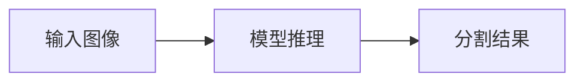

# 403F's Cafe

Astro Paper 驱动的个人博客，面向中文内容维护。

## 本地开发

```bash
pnpm install
pnpm dev
```

## 内容迁移

当前仓库已切换为 Astro Paper 内容结构。迁移脚本保留用于审计和复现；若需要重新迁移，先从 `main` 或历史提交恢复旧 `content/` 目录，再运行：

```bash
pnpm migrate:hugo
pnpm validate:migration
```

迁移策略：

- 只迁移 `content/post/*/index.md` 中文文章。
- 不迁移英文翻译、旧 URL、SEO redirect 或评论系统。
- Hugo `details` shortcode 会转换为标准 HTML `<details>`。
- post bundle 资源会复制到 `public/posts/<slug>/`。

## Mermaid图表

Markdown和MDX文章都可以直接使用`mermaid`代码块：

````markdown

````

图表在浏览器中渲染，随站点明暗主题切换；只有包含图表的页面才加载Mermaid。禁用JavaScript、加载失败或图表语法有误时保留可读源码，不影响正文。使用严格安全模式，不支持图表中的JavaScript点击回调。

修改渲染逻辑后可运行针对性的Markdown转换测试：

```bash
node --test tests/mermaid-markdown.test.mjs
```

## 构建验证

```bash
pnpm sync
pnpm astro check
pnpm build
pnpm preview
```

构建产物输出到 `dist/`。
