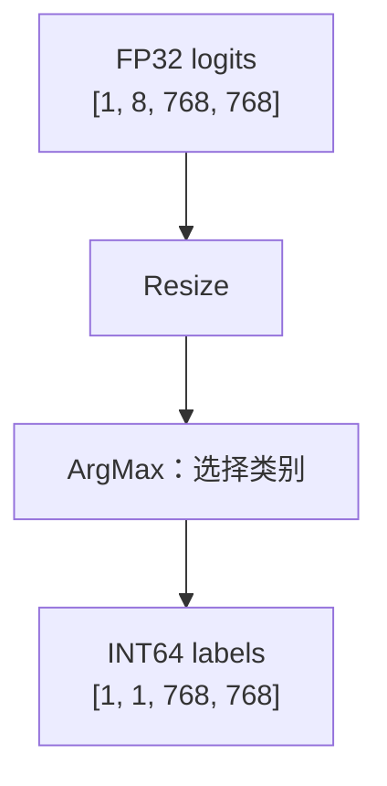
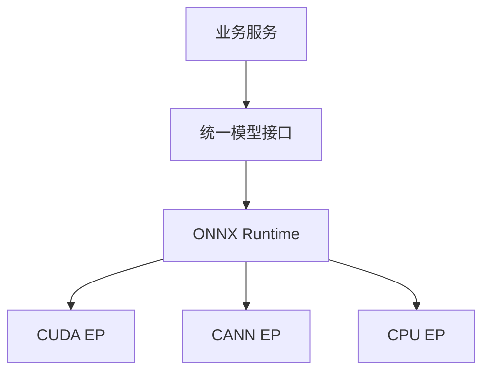
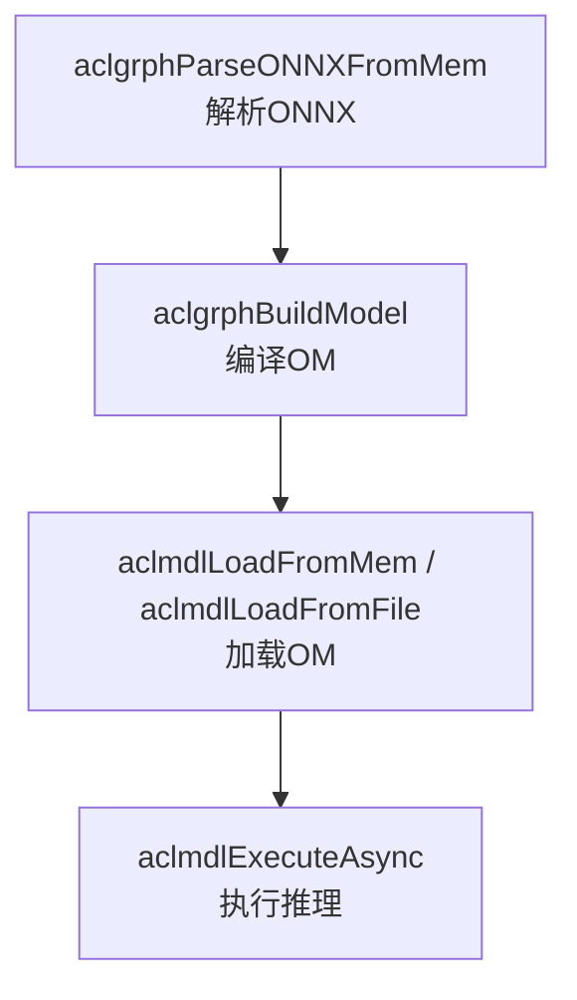

> 最近需要把之前在NVIDIA GPU上训练的IceFormer分割模型部署到华为昇腾上。原本觉得导出一个ONNX，再用ONNX Runtime的CANN后端跑一下就完事了，结果从运行库版本、Python环境一路折腾到算子和图优化，最后才把独立模型的纯NPU推理跑通。本文记录一下中间踩过的坑，免得下次再来一遍。

最终得到的是 **opset13 + ORT BASIC图优化 + CANN EP**。这时的推理图里没有交给CPU执行的节点，读图、预处理和保存结果还是在CPU上做的。虽然说可以用ORT跑了，但是CANN EP的执行效率极低，查了下社区有说部分情况下会比CPU EP还慢，因此后续如果要生产部署的话，大概率还得是转成OM做好优化后直接OM运行。

## 先把模型和测试数据打包

模型原来用的是MMSegmentation，同时依赖MMCV和MMEngine。部署时准备走ONNX Runtime，其通过Execution Provider，也就是EP，把计算交给不同的后端；昇腾对应的是CANN EP。

这次模型输入是四波段图像，输出是八个类别的分数，尺寸如下：

```text
输入：FP32 [1, 4, 768, 768]
输出：FP32 [1, 8, 768, 768]
```

输出的logits还不是最终的分割图，需要经过logits上采样+ArgMax后才是最终结果。

一开始我把ONNX、测试图像、标注、配置和权重来源打成了一个bundle，顺带放进去在NVIDIA CUDA上生成的PTH参考预测。这样搬到服务器上之后，至少能保证用的是同一份输入，不至于环境还没查清楚，先被预处理差异坑一遍。

```python
restored = torch.nn.functional.interpolate(
    logits,
    size=(768, 768),
    mode='bilinear',
    align_corners=False,
)
prediction = restored.argmax(dim=1)
```

为了让服务器上的后处理也一致，我直接在ONNX后面追加了Resize和ArgMax：



<details>
<summary>ONNX后处理节点</summary>

```python
from onnx import helper

# roi和scales是空的FP32 initializer。
# sizes是INT64 initializer，内容为[1, 8, 768, 768]。
resize = helper.make_node(
    'Resize',
    ['logits', 'roi', 'scales', 'sizes'],
    ['resized_logits'],
    mode='linear',
    coordinate_transformation_mode='half_pixel',
)
argmax = helper.make_node(
    'ArgMax', ['resized_logits'], ['labels'], axis=1, keepdims=1,
)
```

包里的几个图共用外部权重文件，只是把权重放到了图文件外面，并没有改模型的计算。

</details>

结果第一版包在服务器上就没跑起来。最开始是节点被分给CPU，但我禁止了CPU回退导致的问题，允许回退后这里过了；但是这时已经交给CANN的节点计算图还是报错。

## CANN版本先踩一坑

ORT最后抛出来的异常往往没什么用，真正的报错在前面的CANN、GE或者ACL日志里，所以先把日志打开：

```bash
export ASCEND_GLOBAL_LOG_LEVEL=1
export ASCEND_SLOG_PRINT_TO_STDOUT=1
```

ORT这边也可以开详细日志：

```python
options = ort.SessionOptions()
options.log_severity_level = 0
options.log_verbosity_level = 1
```

查了一轮发现服务器装的是CANN 9.1，而我用的是`onnxruntime-cann 1.22.1`。[官方版本表](https://onnxruntime.ai/docs/execution-providers/community-maintained/CANN-ExecutionProvider.html)给出的配套关系是：

| ORT-CANN | CANN |
| --- | --- |
| 1.22.1 | 8.2.0 |

既然9.1不在这个组合里，那就先处理环境，而不是接着改模型。之后我实际装的是 **CANN 8.2.RC2**，重新加载环境再跑，依然报错。版本问题要解决，但它并不是后面所有问题的原因。

> 此处之所以不采用本地编译，是因为服务器是ARM架构的，同时环境里的CMake和GCC都太老了，还不允许升级其版本，因此只能是通过这种办法绕过去。

机器上有多套CANN时，还得确认当前shell到底在用哪一套：

```bash
printf '%s\n' "$ASCEND_HOME_PATH"
printf '%s\n' "$LD_LIBRARY_PATH"
command -v atc
npu-smi info
```

`latest`软链接和环境变量都有可能还指着旧版本。安装完不等于切换完，需要加载目标版本的`set_env.sh`，实在混乱就开个新shell再试。

## 先不管ORT，试试直接转OM

换完版本还是跑不起来，于是先绕过ORT，拿测试ONNX直接用ATC转OM。ATC是昇腾的模型转换工具，OM则是昇腾可以加载执行的模型格式。

这么做主要是想先看看，抛开ORT之后，这个测试模型到底能不能被CANN编译。否则转换、初始化、执行全混在一起，根本不知道该从哪里查。

### uv环境找不到python3-config

第一步就被Python环境卡住了。ATC需要用`python3-config`获取Python开发配置，我一直都使用uv来管理虚拟环境，但是uv不会处理python3-config的链接。试着把`python3-config`链接进venv也没用，改PATH同样没有解决，因为ATC处理的时候是不认PATH里的`python3-config`地址的。

我没继续跟ATC的查找方式较劲，先单独建了一个Conda环境做转换测试，由于ATC要求`numpy<2`，同时ARM服务器又没法编译，因此只能用带whl的`Python 3.10`。不是说uv一定不能用ATC，只是这次手动链接这条路没走通，应用和后面的独立推理程序还是继续用uv。

排查时可以先看这几个东西是不是来自同一套Python：

```bash
python -VV
command -v python
command -v python3-config
python3-config --includes
python3-config --ldflags
python -c 'import sys, sysconfig; print(sys.executable); print(sysconfig.get_config_var("LIBDIR"))'
```

### 缺失依赖

另外ATC还得手动补上`decorator`、`attrs`、`psutil`和`scipy`，不然汇报错：

```bash
conda create -n atc-py310 python=3.10 -y
conda activate atc-py310
python -m pip install 'numpy==1.26.4' decorator attrs psutil scipy

# 再加载实际安装的CANN环境。
# source /实际安装路径/set_env.sh
```

### 动态库路径也要查

中间还碰到了动态库和glibc相关报错，又回头检查了一轮`LD_LIBRARY_PATH`。

```bash
printf '%s\n' "$LD_LIBRARY_PATH"

# 对日志里实际报错的共享库检查依赖。
# ldd /实际报错的共享库.so
```

如果加载的是旧CANN或者Conda里的错误库，调整搜索路径可能就够了；如果系统glibc真的比二进制要求的版本低，改路径也不一定能救，还是得换兼容的二进制或运行环境。

这些环境问题处理完之后，测试ONNX终于转成了OM：

```bash
SOC_VERSION='<实际设备的SoC型号>'

atc \
  --framework=5 \
  --model=test.onnx \
  --output=test_model \
  --input_format=NCHW \
  --input_shape='input:1,4,768,768' \
  --soc_version="$SOC_VERSION"
```

输入名称、尺寸和SoC都要换成实际值，转成功至少说明这份测试ONNX能在当前环境下编译。

## 转完OM继续折腾ORT

如果只部署这一个模型，直接用OM可能就够了。但我后面不一定只部署一个模型，也不想每换一种设备就把上层服务重写一遍。

我更想要的是业务只管输入输出，设备差异尽量留给ORT处理：



所以ATC转成功之后，还是回头继续查ORT。这里是希望尽量复用应用实现，部署到不同机器时仍然需要对应的ORT构建、EP库、驱动和硬件运行库。

另外，`get_available_providers()`里能看到CANN，也不代表当前模型就能跑。算子兼容性、图优化、实际推理EP有没有fallback到CPU，都得单独检查。

应用侧我还是用uv锁依赖，最终只跑ONNX的项目不需要MMSegmentation，也不需要torch_npu。

注意不要同时装CPU版`onnxruntime`和`onnxruntime-cann`，它们导入时都叫`onnxruntime`，装在一起可能互相覆盖。

## 把模型从训练框架里拆出来

原来整套MMSegmentation项目还包着注册器、预处理和导出适配，排查时不太方便判断问题出在哪里。我干脆把IceFormer抽成了纯PyTorch实现，先看看模型本身在NPU上能不能跑。

抽完之后不再依赖MMSegmentation、MMCV、MMEngine和timm，attention使用原生的`nn.MultiheadAttention`。权重加载则直接开严格检查：

```python
model.load_state_dict(state_dict, strict=True)
model.eval()
```

少一个参数就报错，避免参数变成随机初始化的。训练checkpoint里还可能带着框架的日志对象，所以能用验证过的纯`state_dict`就尽量用它；必须读原checkpoint时，只处理已知的元数据类型，碰到未知框架对象就停下来。这里默认权重来源可信，自定义unpickler并不能让恶意pickle变安全。

之后用`torch_npu.contrib`里的`transfer_to_npu`做测试，保留CUDA风格的调用，把执行迁移到NPU：

```python
import torch
import torch_npu
from torch_npu.contrib import transfer_to_npu

if not torch_npu.npu.is_available():
    raise RuntimeError('NPU unavailable; CPU inference fallback is forbidden')

# model是抽出来的模型，inputs使用与原模型一致的预处理。
torch.cuda.set_device(0)
model = model.eval().cuda(0)
inputs = inputs.cuda(0)

with torch.no_grad():
    logits = model(inputs)
torch.cuda.synchronize()

assert logits.device.type == 'npu'
assert torch.isfinite(logits).all().item()
```

这次跑通了，说明模型至少能走当前的PyTorch NPU执行路径。但PyTorch能跑，不代表导出成ONNX之后也能跑，后者还要经过另一套算子转换和编译。

## ONNX最后还是用了opset13

导出时我另外起了一个进程，用CPU做tracing，避免`transfer_to_npu`对API的修改影响导出，这里用CPU只是为了生成标准ONNX。

需要在导入torch之前关掉后端自动加载，启动导出子进程时也传入这个环境变量：

```python
import os
os.environ['TORCH_DEVICE_BACKEND_AUTOLOAD'] = '0'

import torch
```

关键导出配置如下，模型已经加载了对应权重，示例输入也按原来的方式预处理：

```python
model = model.cpu().eval()
inputs = inputs.cpu()

with torch.no_grad():
    torch.onnx.export(
        model,
        inputs,
        'model.onnx',
        input_names=['input'],
        output_names=['logits'],
        opset_version=13,
        export_params=True,
        do_constant_folding=True,
        dynamo=False,
    )
```

导出之后再跑ONNX checker，顺便检查有没有意外带进去的自定义算子domain。

一开始导出用的是opset17，后来把两份图放一起看，发现差别还挺明显：

| 项目 | opset17 | opset13 |
| --- | ---: | ---: |
| 网络节点数 | 4925 | 6535 |
| LayerNormalization | 161 | 0 |
| 常量Mod | 52 | 52 |
| 输入 | FP32 `[1,4,768,768]` | 相同 |
| 原始输出 | FP32 `[1,8,768,768]` | 相同 |

opset17会把LayerNorm导出成一个`LayerNormalization`节点，而opset13会把它拆成`ReduceMean`、`Sub`、`Pow`、`Add`、`Sqrt`、`Div`等基础算子，再做仿射变换。

问题在于，ORT-CANN 1.22.1的图模式算子名单没有`LayerNormalization`，但有拆开之后的这些基础算子。所以这里节点更多的opset13反而更合适。降到13之后，那52个Mod仍然在，后面还要继续处理。

## torch_npu和ORT别放一起初始化

中间还试过在同一个进程里先跑PyTorch NPU，再跑ORT CANN，结果报了：

```text
ACL_ERROR_REPEAT_INITIALIZE
expr=aclInit(nullptr)
```

这时torch_npu已经初始化过ACL，CANN EP又尝试初始化，于是重点查同进程重复初始化的问题。

我没有在模型和NPU张量还活着的时候强行调用`aclFinalize()`，免得把已有资源一起弄失效。最后直接拆成两个进程：

- 进程A使用PyTorch和torch_npu，测试模型本身。
- 进程B使用ONNX Runtime CANN执行部署推理，不导入torch和torch_npu。

独立ORT程序只保留NumPy、图像IO、ONNX和ORT-CANN相关依赖。环境里装了torch_npu不等于进程已经初始化它，要隔离的是实际导入和初始化。

## 跑是跑起来了，但怎么还有CPU

换成独立ONNX程序之后，仍然遇到了这个报错：

```text
This session contains graph nodes that are assigned to the default CPU EP,
but fallback to CPU EP has been explicitly disabled by the user.
```

意思很直接，有节点要放在CPU上执行，但我不让它用CPU。

为了先看到结果，我临时加了`--allow-cpu`，允许CANN和CPU混着跑：

```python
options.add_session_config_entry('session.disable_cpu_ep_fallback', '0')
providers = [
    ('CANNExecutionProvider', cann_options),
    'CPUExecutionProvider',
]
```

这次能正常推理了。但目标是纯NPU，接下来就得看看CPU到底在算什么。

`session.get_providers()`只能告诉我有哪些EP，不能告诉我每个节点实际在哪里执行。于是打开ORT profiling：

```python
options.enable_profiling = True
options.profile_file_prefix = 'cann_profile'

# 完成推理后结束profiling，拿到JSON路径。
profile_path = session.end_profiling()
```

<details>
<summary>从profile里查看实际执行的EP</summary>

```python
import json
from collections import Counter

with open(profile_path, encoding='utf-8') as stream:
    events = json.load(stream)

provider_events = Counter()
for event in events:
    arguments = event.get('args', {})
    provider = arguments.get('provider')
    if event.get('cat') != 'Node' or not provider:
        continue
    provider_events[provider] += 1
    print(
        event.get('name'),
        arguments.get('op_name'),
        provider,
        event.get('dur'),  # 微秒
    )
```

推理程序还把这些信息导出成CSV和JSON，按provider、节点索引、名称和算子类型汇总调用次数及耗时。已有profile也可以单独分析，不用每次重新跑模型。

CANN图模式会把多个ONNX节点合成一个子图，ORT profile能看见这个子图交给CANN执行，但看不到OM内部每个算子的硬件耗时。

</details>

### 52个节点都在算2 % 3

看完报告发现，CPU实际执行的全是`Mod`。再查ONNX，这52个Mod的输入全部是INT64常量`[2]`和`[3]`，来自attention层，结果给后面的Reshape和Add使用。

也就是说，不管输入什么图，每次都要算52遍：

```text
2 % 3 = 2
```

这就没必要纠结怎么让NPU支持取模了，直接常量折叠。把图优化改成BASIC：

```python
options.graph_optimization_level = ort.GraphOptimizationLevel.ORT_ENABLE_BASIC
```

改完之后，服务器上禁止CPU回退的CANN推理完整跑通了。之前CPU上只有这些常量Mod，这个结果也符合常量折叠的预期。不过当时没有保存优化后的图，没法再列出具体删掉了多少节点。

### 最后的严格配置

最后使用的session配置如下：

```python
import onnxruntime as ort

options = ort.SessionOptions()
options.graph_optimization_level = ort.GraphOptimizationLevel.ORT_ENABLE_BASIC
options.add_session_config_entry('session.disable_cpu_ep_fallback', '1')
options.enable_profiling = True
options.profile_file_prefix = 'cann_profile'

cann_options = {
    'device_id': '0',
    'enable_cann_graph': '1',
    'dump_om_model': '1',
    'precision_mode': 'must_keep_origin_dtype',
    'op_select_impl_mode': 'high_precision',
}

# 针对ORT 1.22.1，在创建native session之前禁止provider重试。
class StrictCANNInferenceSession(ort.InferenceSession):
    def _create_inference_session(self, *args, **kwargs):
        self.disable_fallback()
        return super()._create_inference_session(*args, **kwargs)

session = StrictCANNInferenceSession(
    'model.onnx',
    sess_options=options,
    providers=[('CANNExecutionProvider', cann_options)],
)
session.disable_fallback()
```

这里还有个坑，**只在构造完成之后调用`disable_fallback()`不够**。1.22.1的Python包装层可能在构造失败时就重试其他provider，等session建好了再禁用已经晚了。

上面重写的是私有方法，只针对这个版本，升级ORT之后需要重新检查，别把它当成稳定的公开接口。

调试时还试过`enable_cann_subgraph`，但在当前版本下报了配置错误。EP选项应该查对应版本的解析源码，不能看在线文档有个选项就直接往旧版里塞。

严格推理另外用了CANN I/O binding，把输入输出都绑定到CANN设备上。下面的例子使用的是同时输出labels和原始logits的后处理图，不是前面只输出logits的原始图：

<details>
<summary>CANN输入输出绑定</summary>

```python
# inputs_np是归一化后的连续FP32 NCHW数组。
value = ort.OrtValue.ortvalue_from_numpy(inputs_np, 'cann', 0)
binding = session.io_binding()
binding.bind_ortvalue_input('input', value)
binding.bind_output('labels', 'cann', 0)
binding.bind_output('logits', 'cann', 0)

session.run_with_iobinding(binding)
binding.synchronize_outputs()
outputs = binding.get_outputs()
assert all(item.device_name().lower() == 'cann' for item in outputs)

# 执行完再传回CPU，做结果比较和保存。
labels_np, logits_np = [item.numpy() for item in outputs]
```

绑定的名称必须和实际ONNX一致，只有logits输出就只绑定logits。

</details>

但输出在CANN设备上，也不能直接证明中间没有CPU计算。最终还是要看profile里的节点：

```python
assert provider_events.get('CANNExecutionProvider', 0) > 0
assert set(provider_events) == {'CANNExecutionProvider'}
```

既要确实执行过CANN节点，也不能夹着CPU或其他EP的计算。

## ORT背后还是在生成OM

后来看了ORT 1.22.1的源码，发现CANN EP在图模式下还是要把接到的图或子图编译成OM，再加载执行，主要调用顺序是：



所以用了ORT并不等于绕过OM，只是这部分工作交给了EP。

这也解释了为什么有些图已经分给CANN，仍然跑不起来。ORT这一版分配节点时主要看算子名单等条件，并没有把所有dtype、属性、形状和算子组合都验证一遍。直接用ATC转整张图，和ORT对子图的编译，输入及参数也不一定相同。

## 总结

最后确认完成的是：

- 测试ONNX通过ATC转成OM。
- 抽出来的模型通过PyTorch NPU执行。
- 独立的opset13模型在BASIC优化下完成严格CANN推理，推理图没有CPU节点计算。
- 图检查确认了161个LayerNorm节点的导出差异，以及52个常量Mod。

## 参考资料

- [ONNX Runtime CANN EP文档与版本依赖表](https://onnxruntime.ai/docs/execution-providers/community-maintained/CANN-ExecutionProvider.html)
- [onnxruntime-cann Python包](https://pypi.org/project/onnxruntime-cann/)
- [ONNX Runtime图优化级别](https://onnxruntime.ai/docs/performance/model-optimizations/graph-optimizations.html)
- [ONNX LayerNormalization定义](https://onnx.ai/onnx/operators/onnx__LayerNormalization.html)
- [Ascend PyTorch兼容性说明](https://github.com/Ascend/pytorch/blob/master/COMPATIBILITY.md)

排查EP行为时看的是ORT 1.22.1对应源码：

- [CANN图分配、解析与OM编译](https://github.com/microsoft/onnxruntime/blob/v1.22.1/onnxruntime/core/providers/cann/cann_graph.cc)
- [子图划分、OM加载与执行](https://github.com/microsoft/onnxruntime/blob/v1.22.1/onnxruntime/core/providers/cann/cann_execution_provider.cc)
- [CANN provider options解析](https://github.com/microsoft/onnxruntime/blob/v1.22.1/onnxruntime/core/providers/cann/cann_execution_provider_info.cc)
- [Python session与fallback](https://github.com/microsoft/onnxruntime/blob/v1.22.1/onnxruntime/python/onnxruntime_inference_collection.py)
