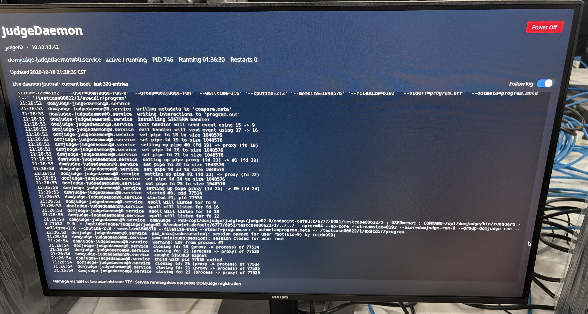

## 目录

## 赛前准备

### 选手机与系统镜像

系统镜像这次基于蔡队的镜像来做。这套镜像分层构建，各部分拆得比较清楚，后面维护和改动都省事，所以结构我直接保留下来，只去掉末尾跟 xcpc tool 有关的内容，再补上这次比赛要用的管理工具和评测环境。

镜像拆成选手版和评测版两个版本，基础环境共用，选手系统、评测系统和安装环境各自配置，两个版本可以独立构建、独立发布。

选手机的管理统一接到 Natsume，原来的初始化、监控和推流方案全部换掉。等待会话和比赛会话的切换、账户权限、用户主目录初始化、命令行提交这些也一并理清，桌面环境迁到原生 Wayland。

评测版镜像集成了 DOMjudge JudgeDaemon 和多语言的隔离评测环境，另外加了一个状态展示和实时日志界面，随时能看到评测机在干什么。资源控制、显卡冷启动的问题也在这个版本里一起修掉了。

评测版镜像的桌面界面长这样。当时忘了专门拍一张展示界面的照片，这张其实是后来排查通信题相关的 JudgeDaemon 挂起问题时顺手留的记录。



安装部署这边也改了：支持分版本自动安装配置，安装过程里设置主机名和网络，注入证书和凭据，再做 CLion 的离线激活。工具链补上了 Rust 的开发与评测支持，还有串流要用的 FFmpeg；构建流程这边，代理配置、文件权限处理、自动化测试和部署文档也都整理了一遍。

这次测试机到得早，跟蔡队聊过之后，我先把串流方案验了一遍。测试机上的 GNOME 已经是 Wayland，原来的方案得跟着改。提前测也带出来一个花屏问题，排查过程写在后面的[「Wayland 串流花屏」](#wayland-串流花屏)。

### 服务器与评测环境

DOMjudge 用的是 20261002 的 snapshot 版本。PHP、MariaDB、session 存储和外榜反代这些配置沿用上一场的做法，细节可见之前几场比赛的技术总结，这里只记本次新增的部分。

#### 提交接口限流

这次新增的是提交接口限流。因为我们配了 `submit` 命令行提交，选手可以直接往 API 发提交请求。如果在最后的时候有人写个循环就可以疯狂交题，可能直接打爆评测机，所以单独给提交接口加了限速。

限速做在 nginx 上，按 IP 算。先在 `http {}` 块里造一个限流键：

```nginx
map "$request_method $uri" $submission_limit_key {
    default "";
    "~^POST /api/(v[0-9]+/)?contests/[^/]+/submissions/?$" $binary_remote_addr;
}

limit_req_zone $submission_limit_key zone=submission_per_ip:10m rate=10r/m;
```

`map` 只看请求方法和路径，只有发往比赛提交接口的 POST 才把来源 IP 作为限流键，其他请求的键是空字符串，nginx 对空键不做限速，排行榜、题目列表这些读接口照旧。正则里的 `(v[0-9]+/)?` 兼容带 API 版本号的路径，`[^/]+` 是比赛 ID，末尾的 `/?` 让不带斜杠的写法也能命中。`10m` 是共享内存区大小，`10r/m` 是每个键每分钟 10 次。

再把限速规则加到 `/api/` 的 location 里：

```nginx
location /api/ {
    limit_req zone=submission_per_ip burst=5 nodelay;
    limit_req_status 429;
    limit_req_log_level warn;

    try_files $uri @domjudgeFrontApi;
    error_log /var/log/nginx/domjudge-api.log;
    access_log /var/log/nginx/domjudge-api.log;
}
```

`burst=5` 允许额外 5 个请求攒着，`nodelay` 让这 5 个立刻处理、不排队等待。这两个数值是按手工提交的节奏定的，一场比赛里一支队伍提交几十次，每分钟 10 次很宽裕。

#### 评测环境

评测机保持和选手机一致的基础系统和组件版本，保证`g++`等都是一致的，只在上层展示页面做了调整，在此不过多赘述。

### 配套服务与工具

#### 打印、管理、气球等

本次打印还是沿用之前的，由服务器直接随机选IP下发任务，但是这场中有个队伍由于电源适配器问题导致鼠标乱跳然后交了好几次一个巨长的文件，由于任务下发的不均衡问题导致一台机器上大量的打印任务积压，而其他机器还在空闲干等，暴露了当前逻辑的一个显著问题，后续会优化这里，应当改为打印机作为Client去Consume Task Queue，未来会一并集成到Natsume里面去。

Natsume选手机管理本次没有这么大的问题，有一点就是有的机器由于小电池没电了，时间不对应，镜像中的NTP服务器我还忘记改为内网的了，导致其会和Natsume Server TLS连接握手失败，卡死在服务器证书鉴权。修复的话，需要手动修改 GRUB 启动参数，进入GRUB，选Ubuntu启动项，按 `e`，找到以`linux`开头的行，在末尾追加

```text
systemd.unit=multi-user.target
```

这样就能进入正常的用户登录tty，使用预先seeded的密码进入系统来修复时间，否则的话会因为Natsume的防御逻辑被完全挡死，进不了命令行。

气球这边，务必记得在正赛前，分几波人分别去数数目对不对，省着志愿者不靠谱糊弄人。（裂开）

#### PXE 批量分发

由于使用的是有线网，经费受限时间有限，没法让志愿者每人一个U盘装，镜像是由PXE分发下去的，这里还是踩了不少坑的。前期调研的时候，考虑到交换机和服务器都是千兆网，单播肯定是不行了，优先考虑了下组播（一开始我以为这就跟那种P2P BT同传一样，后来才发现不是），调研了目前现有的开源工具，最后选择了FOG Project，由于前期测试中，FOG 1.6 Dev版与之前的Release有着巨大的逻辑区别，测试后还是选择在辅助服务器上部署FOG 1.5，但最终结果来看，这并非是Best Practice，418 台机器，分批次传完从配置到结束耗费了一天半的时间。

由于组播要求Client需要和FOG Server位于同一可由交换机转发广播地址的子网下（其实是可以跨多个子网的，但是必须得配置交换机开启IGMP，我当时手头只有一台可配置的核心交换机，其他的都是非网管型交换机，跨子网没有办法搞），迫不得已，只能在FOG Server上同时起了个isc-dhcp-server，然后把服务器和选手机连接到一个子网内，下面是我当时的DHCP配置。

```conf
option space PXE;
option PXE.mtftp-ip    code 1 = ip-address;
option PXE.mtftp-cport code 2 = unsigned integer 16;
option PXE.mtftp-sport code 3 = unsigned integer 16;
option PXE.mtftp-tmout code 4 = unsigned integer 8;
option PXE.mtftp-delay code 5 = unsigned integer 8;
option arch code 93 = unsigned integer 16;

use-host-decl-names on;
ddns-update-style interim;
ignore client-updates;
next-server xx.xx.xx.20;  # 这里是PXE FOG Server的地址
authoritative;

# 这个一定要开
omapi-port 7911;

subnet 10.12.13.0 netmask 255.255.255.0 {
    option subnet-mask 255.255.255.0;
    range dynamic-bootp xx.xx.xx.80 xx.xx.xx.165;
    range dynamic-bootp xx.xx.xx.167 xx.xx.xx.250;
    default-lease-time 3600;
    max-lease-time 7200;
    option domain-name-servers xx.xx.xx.20;
    option routers xx.xx.xx.20;

    # BIOS 客户端
    class "Legacy" {
        match if substring(option vendor-class-identifier, 0, 20) = "PXEClient:Arch:00000";
        filename "undionly.kkpxe";
    }

    # 32位 UEFI
    class "UEFI-32-1" {
        match if substring(option vendor-class-identifier, 0, 20) = "PXEClient:Arch:00006";
        filename "i386-efi/snponly.efi";
    }
    class "UEFI-32-2" {
        match if substring(option vendor-class-identifier, 0, 20) = "PXEClient:Arch:00002";
        filename "i386-efi/snponly.efi";
    }

    # 64位 UEFI
    class "UEFI-64-1" {
        match if substring(option vendor-class-identifier, 0, 20) = "PXEClient:Arch:00007";
        filename "secureboot/snponly-shimx64.efi";
    }
    class "UEFI-64-2" {
        match if substring(option vendor-class-identifier, 0, 20) = "PXEClient:Arch:00008";
        filename "secureboot/snponly-shimx64.efi";
    }
    class "UEFI-64-3" {
        match if substring(option vendor-class-identifier, 0, 20) = "PXEClient:Arch:00009";
        filename "secureboot/snponly-shimx64.efi";
    }
}
```

配置DHCP的时候一定要注意开启omshell权限，这样的话当后续遇到有些IP被不知道谁申请了后，你可以手动释放掉对应的IP，避免由于DHCP池子没了没法PXE启动，udpcast 按期望的接收端数量等待（--min-receivers），拿不到 IP 的机器不会加入，传输就一直不开始，导致组播Client数不够无法启动。

FOG还要注意设置组播的超时时间，设置里面还有个Multicast的全局最长超时时间，也得改。

FOG在其Web Panel上看不到当前已经连接了的Client数量，因此需要直接看日志文件。

```
sudo tail -f /opt/fog/log/multicast.log.udpcast.*
```

这里会显示UDP报告了的Client数量，也会显示其占用的IP，方便确认地址池内哪些是可以释放的。

FOG的其他操作比如说捕获磁盘镜像等在此不过多赘述，其中没什么坑。后续我会进一步调研BT相关的方法。

### 压力测试与赛前检查

本次测试仍然采用[Onyx](https://github.com/4o3F/Onyx)进行压力测试，测试期间一切稳定没有问题。赛前检查的时候Auto Verifier没问题，题目测试也无误。这里没出啥问题，在此不多赘述。

## 比赛运行

### 热身赛

热身赛的时候一开始选手反应没有运行按钮，我还以为是他们没配置VSC的`launch.json`的问题，结果后来报告说是LSP啥都没有，同时蔡队提醒我是不是权限出了问题，紧急发了个Clarification说明`we have identified a issue`，然后让GPT扫了一遍，发现确实有一个VSC Cpp插件新版本里的executable binary没给正确的权限，还好我当时考虑到可能有这种情况在Natsume里面留了紧急入口，导出所有的IP后用parallel ssh给所有设备修复后，发了新的Clarification说明。相关的修复也同步给了上游的蔡队的镜像，也算是帮其他赛站排雷了（给自己脸上贴金ing）

但是赛后的反馈来看，很多选手队伍没有看到说明的Clarification，后续可能要换一种方法，这种提示直接发系统级的而非单纯在网页上发。

### 正式赛

热身赛结束后导题的时候，发现了一个DOMjudge和JudgeDaemon的bug，详情可见[DOMjudge issue 3864](https://github.com/DOMjudge/domjudge/issues/3864)，主要是由于这次出题组的人导题途中让我发了一次JudgeHost Heatup，触发了一个JudgeDaemon的清理隐藏问题，等上游修复后再说。

正赛期间，服务器负载整体正常，但是宽带有间歇性打满情况，虽然应当是没什么影响，可能是由于本次采用了所有连接都上TLS，TLS终结没有前置导致的问题，由于核心交换机口不够，目前来看也没法走链路聚合，考虑到最消耗网络的DOMjudge已经上了Brotli，同时Natsume也是长连接WebSocket+ProtoBuf，暂时没什么其他的可以优化的地方了，若此处有更好的方案，麻烦指点一二。

在几道签到题众多选手通过后，开始有人尝试交互题，这时候开始有评测机直接挂起卡死，正赛期间由于时间紧迫完全没空详细Debug，只能安排人看着哪台死了直接重启，万幸其他测试点会WA，不影响最终的评测结果，赛后和DOMjudge群内各位的讨论和后续GPT的分析，都指向于JudgeDaemon在处理交互题pipe时候的一个兜底问题，详情可见[DOMjudge issue 3878](https://github.com/DOMjudge/domjudge/issues/3878)，在上游未修复前，建议是要求出题组保证交互输入不会超过1MiB，或者是更改评测程序的逻辑来绕过最大pipe 1MiB的问题。

### 滚榜与颁奖

滚榜的时候，发现Pyrite对于前三名的处理逻辑有缺陷，未能正确处理打星队，紧急修复后恢复正常，其他部分基本符合预期，就是现场志愿者打单子出终榜有点太慢了也。

滚榜时还有个图片对不上的问题，现场给队伍照相之后，照片和队伍ID对不上，滚榜放出来的图就错位了。一边照相一边还要志愿者核对队伍ID，确实难为他们。

## 其他踩坑记录

### 镜像制作与部署

镜像做下来，除了功能适配，还踩了不少启动时序、文件权限和构建环境上的坑。这些坑大多只在冷启动、换个源码检出目录、或者切换运行用户之后才会复现。

#### 自动登录早于显卡就绪

评测机镜像最开始考虑的是用在和选手机一样的机器上，因此没考虑独立显卡+没核显的问题，然后评测机冷启动会进不了 Kiosk 界面，等一会儿后手动重启 GDM 又能进去。分析后发现差别在 `nouveau` 初始化显卡的速度，GDM 开始自动登录时，真实的显卡设备还没出现，自动登录的重试次数在等待里就用完了，导致的问题。

最后我把等待挪到 GDM 启动之前：先认出这台机器用来启动的显卡，再等它对应的真实 DRM 设备出现、udev 初始化完成。之后再开始启动，就没问题了。

#### 复制配置时把系统目录权限改掉了

另一个坑在配置文件的复制方式上。同一份镜像构建源码换个检出目录，做出来的镜像权限就不一样，有时连 `/etc` 这种已有系统目录的权限都被改掉，最后卡在安全检查上。

原因在 `cp -a`：源文件、源目录的权限会一起搬过来，属主可以另说，权限位一定会被照搬。而 Git 不记录完整的文件系统权限，所以同一份代码放到不同检出目录，权限本来就可能不同，镜像权限也跟着检出目录一起变。

这里我换成 `rsync` 来合并配置，保留目标已有的权限，只按需要更新文件的可执行位，新建的文件和目录套用统一的权限规则。冻结用户主目录模板之前，还单独把 `/etc/skel` 根目录的权限改成 `0755`，免得模板目录自己的权限问题被带进每个用户的`Home`目录。

#### cgroup 初始化成功，控制器仍然可能不可用

cgroup 初始化服务报成功，评测要用的控制器还是可能用不了。测试时就遇到过初始化跑完，`memory`、`cpuset` 这两个控制器没法稳定使用。

原因是 systemd 和上游 `runguard` 管控制器的方式打架：systemd 按自己的层级管理控制器，`runguard` 直接去动 `/sys/fs/cgroup/domjudge` 下面的文件。我在 JudgeDaemon 的 systemd 服务单元里加了控制器委派：

```ini
[Service]
Delegate=memory cpuset
```

这几个控制器交给服务自己管之后，`runguard` 才能在 domjudge 的 cgroup 下正常使用。

#### 评测机批量安装的主机名与配置写回

批量安装时所有机器共用同一份 autoinstall 配置，装出来主机名全一样。可要是把 identity 整段放开成交互，又会挨个问账号密码，批量安装就白做了。所以只在安装早期问一次 Hostname，其余配置照旧自动填。

安装命令以 root 跑，这时候没有桌面环境可以直接弹窗。我的做法是先等 Live 用户的图形会话起来，再借那个用户的 systemd 管理器弹输入框：

```bash
systemd-run --user --machine="${live_user}@.host" \
    --wait --pipe --collect \
    zenity --entry --text="请输入本机唯一的 Hostname"
```

输入在 early-commands 阶段校验，改的是安装器之后真正读取的那份工作配置；Live 系统自己的主机名不要碰，改了会干扰安装器。用户取消弹窗就直接终止安装。格式校验只管短主机名合法，全场唯一还得靠事先规划命名，比如 judge01、judge02 这样：

```python
# 限制短主机名格式，并为 DOMjudge 追加的 “-0” 预留长度。
if not re.fullmatch(r"[a-z0-9](?:[a-z0-9-]{0,60}[a-z0-9])?", hostname):
    raise ValueError("Hostname 格式不合法")

document["identity"]["hostname"] = hostname
```

主要要注意写回这一步，配置由 root 改，安装前端却以 Live 用户身份去读，导致权限不足。所以写回前先记下原文件的属性，写到临时文件上再恢复，最后才替换：

```python
metadata = seed.stat()
# YAML 写入临时文件并刷新后：
os.fchown(stream.fileno(), metadata.st_uid, metadata.st_gid)
os.fchmod(stream.fileno(), stat.S_IMODE(metadata.st_mode))
os.replace(temporary, seed)
```

### Wayland 串流花屏

赛前跟蔡队聊的时候提到了新版Wayland的串流问题，正好我这回提前拿到了机器就先测试下 Wayland 串流。最初尝试的时候发现远端收到的画面是花的。查到最后是采集到的帧缓冲（framebuffer）用了这套软件组合处理不了的渲染压缩格式，编码和传输参数都没问题。

#### 采集到的缓冲区格式不对

当时主画面在 Plane 0，分辨率 1920×1080，像素格式是 `XRGB2101010`，也就是 10-bit 的 `XR30`。它的 modifier，即描述缓冲区内存布局和压缩方式的标记，是：

```text
I915_FORMAT_MOD_Y_TILED_GEN12_RC_CCS_CC
0x100000000000008
```

这个 framebuffer 还带 CCS 和 clear-color 两个辅助层，用的是 Intel Gen12 的渲染压缩。当时用的 FFmpeg 和 iHD 导入这种缓冲区时解压不对，采集这一步读出来的画面已经是坏的。后面不管是直接看画面，还是接着做硬件编码和推流，出来的都是花屏。

中间我试过设GRUB启动参数的 `enable_fbc=0`，仍然没用。这个开关管的是 Intel 的 FBC，和这里的 CCS 渲染压缩是两套东西。Plane 5 看着能用，它是 linear 的 `ARGB8888`，可 pitch（每行数据的字节跨度）只有 1024 字节，装的是光标，不能拿来当主画面采集。

#### 从桌面会话中禁用 CCS

采集流程处理不了这种压缩格式，我就让桌面合成器干脆别分配 CCS 缓冲区。做法是往 `/etc/environment.d` 里写一个环境变量文件：

```bash
install -d /etc/environment.d
printf 'INTEL_DEBUG=noccs\n' > /etc/environment.d/99-noccs.conf
```

`install -d` 保证目录存在，有些系统镜像里没有这个目录。`environment.d` 下的文件由 systemd 的用户会话读取，变量在整场桌面会话里都生效，不只是被写进去的那个服务。放在 `/etc` 下对所有用户都生效，选手机和评测机共用同一套镜像时正好省事。

写完要注销重新登录，合成器启动时才会读到这个变量。变量必须作用在桌面会话里，只在跑 FFmpeg 的那个终端里 export 不管用，合成器分配的缓冲区早在登录时就定好了。

重新登录之后，Plane 0 的 modifier 变成：

```text
I915_FORMAT_MOD_Y_TILED
0x100000000000002
```

CCS 和 clear-color 辅助层没了，接着走 VAAPI 映射、转像素格式再编码，画面恢复正常。

#### 最终使用的串流命令

缓冲区格式解决之后，选手机上最后用的是下面这条命令：采集桌面，60 帧 H.264 硬件编码，走 SRT 串流。

```bash
ffmpeg -hide_banner -fflags +genpts+nobuffer -flags low_delay \
  -framerate 60 -device /dev/dri/card1 -f kmsgrab -i - \
  -vf 'hwmap=derive_device=vaapi,scale_vaapi=format=nv12' \
  -an -c:v h264_vaapi -low_power 1 -qp 23 -bf 0 -g 30 -profile:v high \
  -fps_mode cfr -muxdelay 0 -muxpreload 0 \
  -f mpegts "srt://0.0.0.0:9000?mode=listener&transtype=live&latency=60000&tlpktdrop=1&rcvlatency=60000&peerlatency=60000"
```

这里用的是 SRT 的 listener 模式：选手机先监听，谁要看画面谁主动连上来拉流，不用在选手机上预先写死观看端地址。`0.0.0.0:9000` 表示监听本机所有网卡的 9000 端口，远端连接时填选手机的实际 IP。

## 后续改进

### 工具与自动化

后续需要进一步扩展Natsume的功能，将打印的逻辑修正，避免负载不均衡的问题，同时也能让选手在提交任务的时候看到前面还积攒了多少。

Natsume的资源占用也需要进一步优化，目前来看其最高内存占用可达400MB，即使有400 多条长连接也不该占用这么多，而且线程池也常驻 80 多个线程；同时目前Natsume的各种操作没有审计记录，导致有时候换机等操作没有记录时间，出现纠纷的时候没有足够的证据来明确时间戳等。

### 流程与协作

滚榜时候图片对不上的问题，这是志愿者工作的纰漏，考虑到一边照相一边让他们找对队伍ID看来还是太难为他们了，后续扩展Natsume功能，来让选手在照相的时候就确认当前相片和自己队伍信息是否是对应的，也修改Waiting锁屏界面，在信息同步后展示出来，这样要是有错的，可以让选手上报后修正，避免最后出现错误。气球相关的流程还需要进一步培训现场志愿者，至少要求他们把数量数对。

## 总结

本次是耗费我较大精力完整重写的Natsume V2的首次实际应用，从结果上来看其大幅降低了选手机批量操作的工作量，完备的自动恢复体系使得其能够自主处理恢复大多数异常情况，对于其表现我还是比较满意的。后续会写一篇文来整体阐述设计思路，也算是这一年来我在工程领域探索的一份收官之作吧。

本次比赛从技术上来看基本上没什么问题，剩余的其他组的问题，后续会扩展当前的各种自动化工具帮他们兜底。
