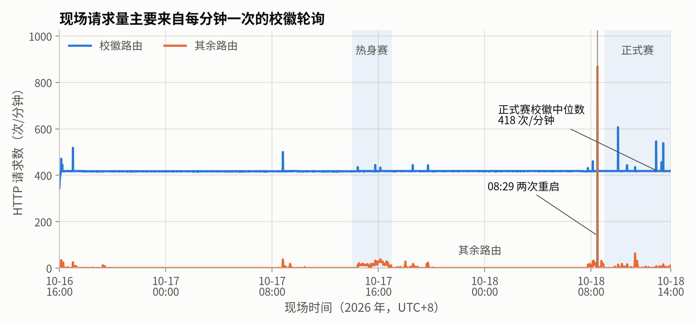
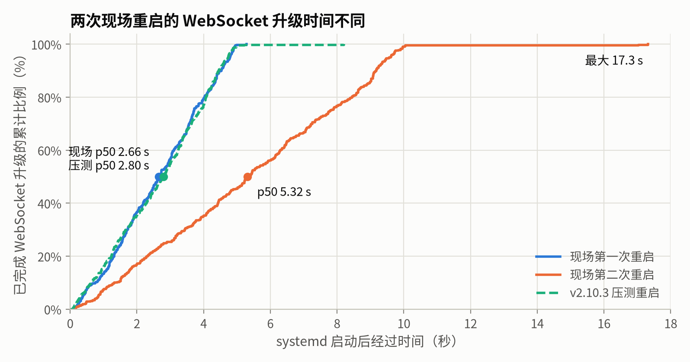
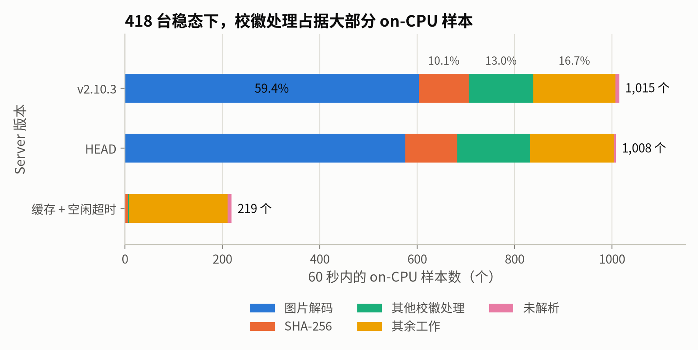
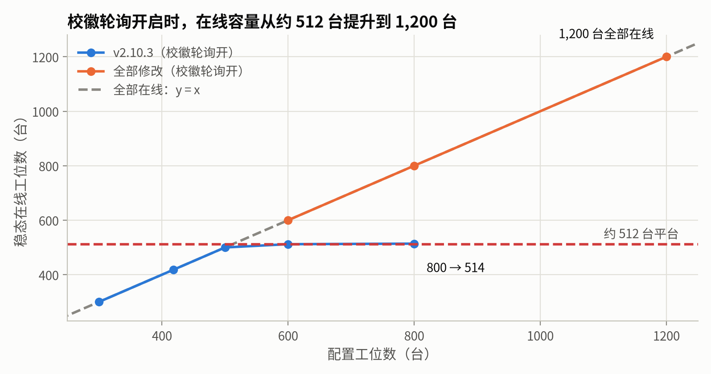
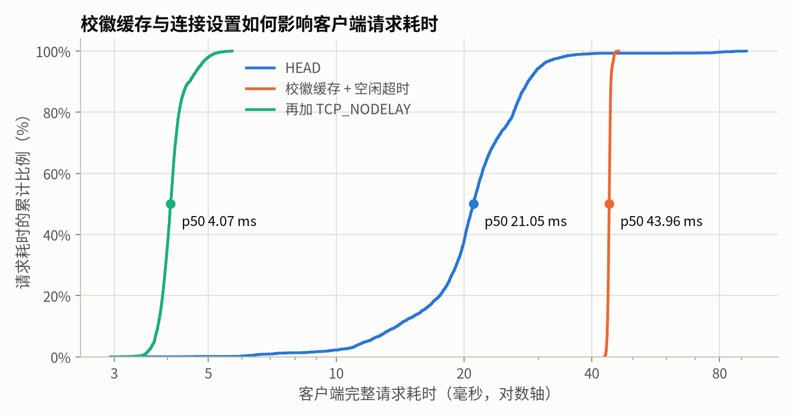
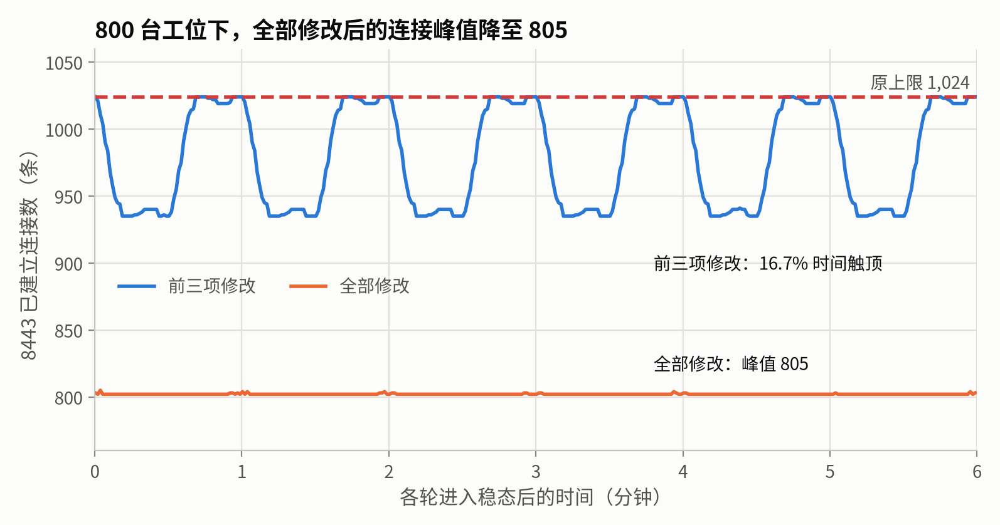

> 上一篇介绍了 Natsume V2 的设计，本篇考察它在西安区域赛中的实际运行情况。赛后可用的现场数据只有一份服务端 journald 日志，日志无法覆盖的部分通过双机模拟 600 台工位的压测补充，因此有了此文。

## 目录

## 数据来源

现场数据为一份 `journalctl -o json` 导出，大小 1.55 GB，共 118.6 万条记录，时间跨度为 10 月 1 日至 10 月 30 日。比赛期间运行的 Server 版本为 v2.10.1，比赛当天早上升级至 v2.10.3，两者的服务端行为一致。该版本尚未引入运营事件日志（operational event journal），Server 写入 journald 的几乎全部是 tracing 输出的 HTTP 请求记录。去除具体取值后，整份日志只有 13 种消息模板，其中 99.9% 为以下形式：

```text
 INFO http_request{… http.route="/api/v2/session" …}: HTTP request completed method=GET route=/api/v2/session status=200 duration_us=833
```

每条记录包含路由模板、方法、状态码与服务端处理耗时 `duration_us`，带会话的请求另含操作员 ID。其余记录为请求拒绝原因、进程启动与关闭事件，以及 systemd 记录的服务启停和资源消耗。

该日志存在两处覆盖盲区。第一是设备控制连接的内部过程：认证结果、断线原因、目标下发至生效的时延、数据库写锁等待均未记录，日志中仅有 WebSocket 升级（101）一条记录，而升级成功并不等同于认证通过。第二是工位端，现场未采集工位日志。因此本节的结论仅限于 HTTP 层面。

## 日志处理

日志以流式单遍解析，逐行读取并就地脱敏输出，单遍耗时约 19 秒。输出只保留时间戳、路由模板、方法、状态码、耗时与拒绝原因，进程、操作员和学校编号替换为别名，主机标识、文件路径与学校名称全部删除；另由一个独立的检查器回读原始日志，确认输出中不含任何原始敏感值。脚本位于仓库的 `bench/analyze/` 目录，脱敏后的逐行数据集压缩后约 10 MB。

## 时间线

将服务进程与 systemd 记录对齐后，比赛前后的时间线（UTC+8）如下：10 月 15 日 13:37 服务器开机，Server 进程 `p04` 启动；10 月 16 日 16:00 起工位陆续上线，此后请求量稳定在每小时约 2.5 万次；10 月 17 日 14:00 至 17:00 为热身赛，面板设备列表的刷新请求明显增加；10 月 18 日 08:29:04 升级至 v2.10.3，`p04` 退出、`p05` 启动，8.3 秒后再次重启为 `p06`；09:00 至 14:00 为正式赛；19:30 服务器搬迁时断电，此后的记录不在本文范围内。



systemd 在进程退出时记录资源消耗，`p04` 的记录为：

```text
natsume-server.service: Consumed 7h 10min 1.293s CPU time over 2d 18h 51min 10.860s wall clock time, 696.2M memory peak.
```

同一台机器上其他时段的进程，CPU 时间一般为数秒至数分钟，内存峰值在 70 至 320 MB 之间。`p04` 运行期间没有任何导入或导出操作，即 7 小时以上的 CPU 时间与接近 700 MB 的内存峰值均发生在稳态负载下：418 台工位在线，少数运维人员使用面板。办赛总结中记录的约 400 MB 内存来自 htop 观察，systemd 记录的是包含页缓存的 cgroup 内存峰值，因此数值更高。

## 校徽请求

按路由统计请求量，`GET /api/v2/organizations/{organization_id}/logo` 占绝对多数，且几乎全部返回 304（Not Modified）。全量日志中，这一路由的 304 响应占全部请求的 98.34%，热身赛 3 小时内占 96.89%，正式赛 5 小时内占 99.22%（126,527 次请求中的 125,546 次）；只看这一路由自身，304 的比例在三个窗口中都在 99.7% 以上。

正式赛期间该路由每分钟稳定为 418 次（p1 为 417，p50 为 418），与工位数量一致，即每台工位每分钟一次。来源位于工位 Daemon（`crates/natsume-workstation-daemon/src/reconcile/presentation.rs`）：等待界面需要显示本校校徽，为了在目标未变化时也能感知校徽文件的替换，Daemon 每 60 秒携带上一次的 ETag 发送一次条件请求：

```rust
() = tokio::time::sleep(Duration::from_mins(1)) => {}
```

条件请求本身符合 HTTP 缓存语义，问题在于服务端的响应路径。304 响应理论上只需比较 ETag，应在亚毫秒级完成，而现场实测 p50 为 20.4 ms，p99 为 60.5 ms，最大值 233.9 ms。作为对照，`GET /api/v2/session` 的 p50 为 0.77 ms。

服务端的处理流程（`crates/natsume-server/src/http/handler/contest/organization.rs` 与 `component/contest/logos.rs`）中，每个条件请求依次执行：加载全部学校并线性查找目标；获取 `image_work` 信号量许可（共 4 个，面板的校徽检查也使用该信号量）；在阻塞线程池中扫描校徽目录、建立索引、按校名匹配文件；读取文件并完整解码图片，SVG 还需每次栅格化为 PNG；对完整图片字节计算 SHA-256 作为 ETag；最后与 `If-None-Match` 比较并返回 304。也就是说，判定"图片未变化"的代价等同于一次完整的图片处理。

按路由汇总处理耗时，`p04` 全部请求的累计处理耗时为 6.34 小时，其中校徽路由 6.32 小时；正式赛当天的 `p06` 为 0.88 小时，校徽路由同样占 0.88 小时，两个进程的占比均为 99.6%。处理耗时不等同于 CPU 时间，并发请求的区间会重叠，等待信号量的时间也计入其中；但图片解码与哈希计算属于 CPU 密集操作，且 `p04` 的 CPU 时间（7 小时 10 分）与校徽处理耗时（6.32 小时）处于同一量级。据此推断，现场服务端的 CPU 主要消耗在校徽请求上，该推断尚需 perf 采样验证。

这一开销在比赛中没有引发故障。以 418 台、每分钟一次、每次 20 ms 计算，平均占用约 0.14 个核，在 48 线程的服务器上不易察觉。潜在风险在突发场景：赛前统一开机或 Server 重启后，数百台工位会在数秒内集中请求校徽。若 418 个请求同时到达，在 4 个许可、单次 20 ms 的条件下，最后一个请求需排队约 2 秒（418 × 20 ms ÷ 4），这是理论上限；实际到达时间被工位的重连退避分散，压测中的实测结果见后文。DOMjudge 导出虽然使用独立的信号量，但同样在阻塞线程池中解码图片，现场 3 次导出的耗时均约 4.95 秒，与突发请求叠加时会进一步延长。

## 重连

10 月 18 日 08:29 的两次重启提供了一份真实的重连数据：418 台工位同时断开并重新连接。以 systemd 记录的启动时间为零点，统计其后 600 秒内的 WebSocket 升级。两次重启都是 418 次升级：第一次（`p05`）p50 为 2.66 s，p99 为 4.92 s，最大 5.28 s，峰值速率 97 次/秒；第二次（`p06`）p50 为 5.32 s，p99 为 9.98 s，最大 17.3 s，峰值速率 56 次/秒。图中的虚线是后文压测中重启 v2.10.3 的结果。



两次分布的差异由工位的重连退避策略决定（`crates/natsume-workstation-daemon/src/control/connection.rs`）：

```rust
const INITIAL_RECONNECT_WINDOW_MS: u32 = 5_000;
const MAX_RECONNECT_WINDOW_MS: u32 = 30_000;
const STABLE_ACTIVE_DURATION: Duration = Duration::from_mins(1);
```

每次重连前在 `[0, 窗口]` 内均匀随机等待，窗口初始为 5 秒，每次重试后翻倍，上限 30 秒；只有连接稳定超过 1 分钟后，窗口才重置为 5 秒。第一次重启前，工位已稳定连接数日，窗口为 5 秒，因此 418 台工位在约 5 秒内均匀到达。随后它们与 `p05` 的连接只维持了数秒，未满足稳定条件，窗口未重置且已翻倍为 10 秒，因此第二次重启后的到达时间扩展到约 10 秒。最大值 17.3 秒可能对应首次重试失败、进入 20 秒窗口的工位，由于缺少工位端日志，这一点无法确认。

该退避策略于 9 月引入（`3301714`）。现场数据表明其行为符合设计，未出现数百台工位在同一秒集中接入的情况；未打散时 Server 的表现将在压测中以回退补丁进行对照。此外，正式赛 5 小时内仅有 15 次 WebSocket 升级，控制连接整体稳定。

## 其他慢路由

其余耗时较高的路由请求量均较小。面板设备列表 `GET /api/v2/devices` 共 5,686 次，其中热身赛 3 小时内 1,911 次，p50 为 24 ms；该接口仅执行数据库查询，418 台设备的数据量很小，耗时偏高的原因可能是与校徽请求竞争阻塞线程池或数据库连接。学校列表 `GET /api/v2/organizations` 包含校徽检查，160 次请求的 p50 为 11 ms，偶发达到 2 秒。导入预览的学校列表最大耗时 1.86 秒，DOMjudge 导出 3 次均约 4.95 秒。

## 待压测回答的问题

现场日志能够支持的分析到此为止，以下问题需要通过压测回答：校徽请求在 perf 采样下的实际 CPU 占比，以及突发场景下的排队时延；`p04` 接近 700 MB 内存峰值的来源；设备控制面（认证、收敛、数据库写锁）在 418 台与 600 台规模下的表现及瓶颈位置；上一篇所述的重连打散、只读目标计算、有界阻塞任务等设计各自的实际收益。

## 压测环境与方法

压测使用两台与比赛服务器同型号的机器：A（2 × Xeon Silver 4116，48 线程，61 GB 内存，SATA SSD）运行被测 Server，B 运行负载生成器，两者通过 1 GbE 直连，往返时延约 0.2 ms。被测版本为现场使用的 v2.10.3，以独立的 systemd 单元部署在 A 上，沿用现场的 TLS 证书与 8443 端口，数据目录与生产安装隔离。每次实验前从同一份基线快照恢复数据，负载生成器固定在 B 的 NUMA node 0 上运行。

负载生成器 `natsume-loadgen` 是仓库中的一个 workspace crate，复用工位端的协议实现，每个模拟工位持有独立的 Ed25519 身份，完成真实的 TLS 1.3 握手、WSS 注册或恢复、完整状态快照交换和 30 秒心跳。重连退避与 Daemon 一致（初始窗口 5 秒，逐次翻倍至 30 秒，稳定 1 分钟后重置）；校徽轮询同样每 60 秒一次，ETag 跨重连保留；每个模拟工位使用独立的 HTTP 连接池，保持与真实 Daemon 相同的连接行为。面板负载由同一工具中的 Operator 驱动产生，按现场热身赛的频率轮询各接口（设备列表约 10.6 次/分钟）。合成校徽按现场校徽的字节数与尺寸分布生成（p50 约 83 KB，尺寸中位数 1024×1024）。实验编排位于仓库 `bench/run/`，日志分析沿用现场复盘所用的 `bench/analyze/`。

### 保真度检验

在设计目标规模之前，先确认实验环境能复现现场。以 418 台工位、2 个面板的负载运行 v2.10.3，稳态 30 分钟，再用同一套脚本分析被测 Server 的 journald，与现场正式赛窗口对比：校徽 304 的 p50 为 20.8 ms（现场 20.4 ms，+2.3%），设备列表 p50 为 26.7 ms（现场 25.8 ms，+3.2%），会话接口 p50 为 0.85 ms（现场 0.77 ms，+10%），校徽请求每分钟 418 次，与现场一致。尾部延迟偏短（校徽 304 的 p99 为 38 ms，现场为 61 ms），原因是合成校徽的解码耗时分布尾部较轻，且实验中没有现场那样的其他操作。整体上，实验环境在中位数层面复现了现场的 HTTP 行为。

同一次运行中，8443 端口的已建立连接数全程为 838，其中负载生成器 836 条、面板 2 条，即每台工位 2 条连接。这一点在下一节中是关键。Server 稳态平均 CPU 为 0.166 个核，RSS 峰值 531 MiB。

## 瓶颈分析

### 校徽请求的 CPU 开销

在 418 台工位的稳态下，以 `perf record -F 99 --call-graph fp` 对 Server 进程采样 60 秒，共 1,015 个 on-CPU 样本。按调用栈归类，校徽路径合计占 82.6%，其中图片解码 59.4%，SHA-256 10.1%，其余校徽处理（加载学校、扫描目录、匹配文件）13.0%；Server 的其他全部工作（设备控制、面板接口、TLS 等）合计 16.7%。容量阶梯实验从另一个角度给出了相同的结论：600 台工位时，开启校徽轮询的 Server 平均 CPU 为 0.205 个核，关闭轮询后为 0.035 个核，校徽轮询约占 83%。第一部分根据日志做出的推断由此得到验证。



另外测量了三种突发场景，结果如下：

| 场景 | 校徽请求 p50 | p99 | 最大值 | 说明 |
| --- | ---: | ---: | ---: | --- |
| 稳态 | 20.9 ms | 36.0 ms | 77.4 ms | 304 |
| Server 重启后 | 24.5 ms | 55.1 ms | 89.2 ms | 304；重连 p50 2.80 s、p99 4.98 s，与现场第一次重启（2.66 s、4.92 s）一致 |
| 缓存清空后集中请求 | 30.3 ms | 91.5 ms | 136.9 ms | 418 台同时走 200 路径，峰值并发 17 |
| 重启叠加导出 | 22.3 ms | 46.0 ms | 84.9 ms | DOMjudge 导出耗时 6.10 s（现场 4.95 s） |

在 418 台规模下，突发会使校徽请求的尾部延迟上升约一倍，但没有出现请求失败；重启后的重连曲线与现场基本一致。单看 CPU，这一开销在当前规模下尚可接受，真正的问题在连接数上。

### 连接容量

保真度检验中观察到的"每台工位 2 条连接"源于两处默认行为的叠加：工位 Daemon 的 reqwest 客户端未设置连接池空闲超时，默认保留空闲连接 90 秒，长于 60 秒的轮询间隔，因此校徽请求所用的 HTTPS 连接从不关闭；Server 端的 `axum::serve` 也不关闭空闲的 keep-alive 连接。而 Server 的 TLS Listener 对所有连接共用一个上限 `MAX_CONNECTIONS = 1024`（`server/src/tls.rs`），WebSocket 与普通 HTTP 连接各占一个许可，取不到许可的新连接在 accept 后被直接关闭。

为确定这一上限对应的工位规模，以 300 至 800 台做了容量阶梯测试，每档稳态 6 至 10 分钟：



开启校徽轮询时，连接数严格等于 2N + 2，在约 511 台时达到 1,024 的上限。超过这一规模后，在线工位稳定在 512 台左右，600 台和 800 台时 8443 连接数都停在 1,024，设备连接分别失败 2,084 次和 6,799 次，失败的工位以 TCP RESET 或 TLS EOF 结束并按退避重试；同时，新的面板会话也因无法建立连接而登录失败，6 次新登录全部失败，已建立的面板连接不受影响。关闭校徽轮询后，800 台工位全部在线，连接数为 N + 2。图中的橙线是后文全部修改之后的结果。

也就是说，按设计目标 500 至 600 台部署时，v2.10.3 会在上限附近运行，超出部分的工位无法接入，运维也可能无法打开面板。西安区域赛的 418 台恰好低于这一拐点（836 条连接）。

## 优化

两个瓶颈的根源都在工位每 60 秒一次的校徽条件请求。可选的修改位置有三处：工位 Daemon（缩短连接池空闲时间、给轮询加随机抖动）、控制协议（在下发目标中携带校徽版本，取消轮询），或者 Server。前两种都需要重新制作并分发工位镜像，我选择只改 Server，使已部署的工位升级 Server 后即可受益。

修改之前先确认赛后的开发版本是否已经解决这些问题。以当前主分支（下文称 HEAD）重跑上述实验，结果与 v2.10.3 基本一致：稳态校徽 304 的服务端 p50 为 20.2 ms，CPU 0.168 个核，perf 中校徽路径占 82.5%；容量阶梯在 600 台时同样只有 512 台在线，新面板登录 0/6。赛后的改动集中在设备控制面，没有涉及这条路径。

### 校徽 304 路径

第一项修改针对 CPU 开销。Contest 组件内新增一个 HTTP 校徽缓存，分两层：第一层缓存"学校 → 校徽文件"的解析结果，以校徽目录自身的 dev/ino/size/mtime/ctime 为失效条件，目录内的增删和改名都会使其失效；第二层缓存每个文件的 ETag，键为文件的 dev/ino/size/mtime/ctime。条件请求命中两层缓存且 ETag 匹配时直接返回 304，不读取文件、不解码、不计算哈希，也不占用 `image_work` 许可。未命中或需要返回 200 时仍走原路径，此时只有在读取前后文件元数据不变的情况下才复用已缓存的摘要。缓存按路径分为 16 个分片，每片最多 64 条，同一分片内的计算单飞（single-flight），避免冷启动时多个请求重复解码同一文件。学校查询也从加载全部学校后线性查找改为按主键查询。

ETag 的取值保持不变，仍是图片字节的 SHA-256。这一点是硬约束：若 ETag 改变，升级后 418 台工位缓存的 ETag 全部失配，第一轮轮询会集体回退到 200 并重新下载图片。实验中升级后的第一轮请求全部为 304。

第二项修改针对连接数。v2.10.3 使用 `axum::serve`，它不提供空闲 keep-alive 连接的超时。我将其替换为一个小型的 accept 循环，对每条连接使用 hyper 的 `http1::Builder` 并设置 `header_read_timeout` 为 30 秒：等待首个或后续完整请求头的时间超过 30 秒即关闭连接。该期限只覆盖等待请求头的阶段，不限制请求正文、handler 执行和响应传输，也不作用于已升级的 WebSocket。原有的 TLS 握手上限、连接许可与优雅关闭语义保持不变。

回归测试覆盖了这两项修改的边界条件。缓存部分：已有的栅格图与 SVG 的 ETag 取值不变；校徽文件被替换、删除、改名，或目录本身被替换后，下一次请求立即反映新状态；读取过程中发生变化的文件不进入缓存；并发的首次请求只计算一次，首个请求被取消也不影响；缓存条目有上界，淘汰后可重新计算。连接部分使用真实 TLS 连接测试：期限内的连续请求复用同一连接；部分请求头不会延长期限；慢速上传、慢速下载和长时间的 handler 执行不受该期限影响；空闲连接在期限后关闭并归还许可；关闭 Server 时空闲连接立即关闭，在途请求处理完成后再退出。

在 418 台、10 分钟稳态下，校徽 304 的服务端 p50 从 20.2 ms 降至 0.70 ms，p99 从 37.1 ms 降至 0.82 ms，Server 平均 CPU 从 0.168 个核降至 0.038 个核。perf 采样 60 秒的 on-CPU 样本从 1,008 个降至 219 个，图片解码不再出现，样本数最多的调用栈是新连接 TLS 握手中的 x25519 密钥交换；样本总量过少，不再细分各部分的占比。

### 新连接上的 40 ms

同一组数据中，负载生成器测得的客户端耗时却从 21.0 ms 上升到 44.0 ms，且分布极窄（p99 为 45.2 ms），与服务端耗时无关。修改空闲超时后，每次轮询都会新建一条 TLS 连接，而一个几乎恒定的 40 ms 出头的延迟，与 Linux 延迟 ACK 的最小值 40 ms 吻合。回看 v2.10.3 的重启实验，重启后所有请求同样都在新连接上，客户端 p50 也是约 43 ms，而服务端只有约 21 ms，说明这一延迟并非本次修改引入，只是此前只在重启时出现。

在 A 上以 128 字节截断长度抓包，只记录报文头。在新建的连接上，客户端发出请求后，Server 先发出一个 184 字节的 TLS 记录，随后 228 字节的 HTTP 响应一直等到客户端对前一个记录的 ACK 到达才发出，8 条连接的等待时间为 40.3 至 41.0 ms，收到 ACK 后 30 至 34 µs 即发送。按 rustls 的写出顺序，184 字节的记录推断为 TLS 1.3 握手后的 NewSessionTicket。这是 Nagle 算法与延迟 ACK 相互等待的典型情形：Server 端未设置 `TCP_NODELAY`，存在未确认的小报文时，后续的小报文被暂缓发送。工位 Daemon 与负载生成器使用的 reqwest 默认开启 `TCP_NODELAY`，因此只需修改 Server。

修改为在 accept 之后、TLS 握手之前对每个连接调用 `set_nodelay(true)`，设置失败时记录警告并继续服务。修改后，同样 8 条连接的响应都在 ACK 之前发出，稳态客户端耗时 p50 为 4.07 ms，p99 为 5.13 ms，服务端耗时与 CPU 不变。



### 轮询相位与连接峰值

随后在 500 至 800 台下重跑容量阶梯。控制面的问题消失了：800 台工位全部在线，没有设备连接失败。但校徽请求出现了大量失败，600 台时为 23%，800 台时为 56%，6 次新面板登录中也有 1 次失败。以 1 秒周期采样 8443 端口的已建立连接数，800 台时有 16.7% 的时间恰好处于 1,024 的上限，所有失败都发生在触顶前后 1 秒内。

原因在于轮询的相位。Daemon 每次轮询结束后固定等待 60 秒，并在目标变化时立即重新请求校徽，没有随机抖动。全场统一下发一次目标，或者 Server 重启后集中重连，都会使所有工位的轮询对齐到同一时刻，此后一直保持对齐。实验中 800 台时 65% 的请求落在同一个 10 秒窗口内。每次轮询打开的连接在空闲 30 秒后才关闭，所以在这个窗口附近，连接数接近工位数的两倍，再次触及 1,024 的上限。缩短空闲超时只能缩短峰值持续的时间，无法降低峰值本身。根本的解决办法是在 Daemon 的轮询间隔中加入随机抖动，这需要更新工位镜像，留待后续的工位端版本；本次仍只在 Server 端处理。

最终的修改分两部分。第一，公开校徽路由的所有响应（200、304 与错误响应）都携带 `Connection: close`，响应发送完即关闭连接。每次轮询本来就会新建连接，这样做不增加握手次数，连接数峰值约等于工位数，与轮询相位无关；其他路由的连接行为不变。第二，`MAX_CONNECTIONS` 从 1,024 提高到 2,048，打包的 systemd 单元中 `LimitNOFILE=4096` 不变，其余文件描述符留给 SQLite、校徽文件与日志；握手并发上限 64 与 5 秒握手期限不变。



### 结果

全部修改后，在开启校徽轮询的条件下重跑容量阶梯，每档稳态 6 分钟：

| 工位数 | v2.10.3 | HEAD | 前三项修改 | 全部修改 |
| ---: | --- | --- | --- | --- |
| 600 | 512 台在线，新登录 0/6 | 512 台在线，新登录 0/6 | 全部在线，校徽失败 23%，新登录 5/6 | 全部在线，校徽全部 304，连接峰值 604，新登录 6/6 |
| 800 | 514 台在线，新登录 0/6 | 515 台在线，新登录 0/6 | 全部在线，校徽失败 56%，新登录 5/6 | 全部在线，校徽全部 304，连接峰值 805，新登录 6/6 |
| 1200 | 未测 | 未测 | 未测 | 全部在线，校徽全部 304，连接峰值 1,210，新登录 6/6 |

800 台时 Server 平均 CPU 为 0.072 个核（v2.10.3 为 0.204），1,200 台时为 0.104 个核，RSS 峰值 518 MiB。1,200 台中有 782 台为首次注册，全部在 13.9 秒内完成接入，期间没有重试，设备控制的短期认证名额也未耗尽；此后的实验中，1,200 台以已有身份同时恢复连接，9.7 秒内全部在线。

重启突发与 DOMjudge 导出的表现与修改前基本一致：重启后 418 台全部恢复约需 8 至 10 秒，由工位的重连退避决定；导出耗时约 6.5 秒，导出期间校徽请求的耗时没有可见变化。这两项本来就不受校徽路径的 CPU 开销限制。

压测在两台没有启用 NTP 同步的机器上进行，编排工具在每轮实验的起止各测量一次两机时钟偏差，并据此线性校正客户端事件的时间戳；所有服务端耗时都只使用 A 的时钟。

上述修改分别位于 #17（校徽缓存与空闲超时）和 #63（`TCP_NODELAY`、校徽连接关闭与连接上限）。实验配置、负载生成器和分析脚本位于仓库的 `bench/` 与 `crates/natsume-loadgen/`，脱敏后的现场数据集与实验结果随文发布。

前文列出的其余问题，包括 `p04` 内存峰值的来源，以及重连打散、只读目标计算等设计各自的收益，本文没有测量，后续另行整理。
