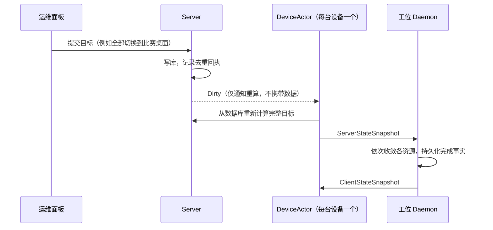

> 西安区域赛的办赛总结中提到，后续会单独整理 Natsume V2 的设计思路，因此有了此文。本文是系列的第一篇，后两篇分别是现场日志复盘与 Server 压测，以及工位端与可靠性测试。

## 目录

## v1 的工作方式

v1 位于仓库的 `v1` 分支，开发周期为 2025 年 4 月至 2026 年 5 月，共 89 个提交，Rust 代码约 2,700 行。结构上由三部分组成：基于 actix-web 的 Server，后端 SQLite 只有 `id_bind` 和 `player` 两张表；基于 Vue 的管理面板，以请求头中的静态 token 鉴权；以及部署在每台工位上的 SUID root 命令行工具。

办赛时的操作流程如下。座位绑定由志愿者在每台工位的终端上执行命令完成。会话切换、Home 清理、账号同步等批量操作，由运维通过 parallel-ssh 向全部工位并发下发命令。工位每 60 秒向 Server 上报一次 `{mac, synced, client_version}`，这也是面板唯一的数据来源，因此面板只能反映工位是否在线，无法反映 pssh 下发的命令是否成功、执行到了哪一步，执行结果只能从 pssh 的终端输出中判断。

设备以 MAC 地址标识，且不做设备认证。由于工位镜像通过磁盘克隆分发，曾出现过 MAC 冲突，两台工位被识别为同一台设备（`ab55df2`、`bdcdacf`）。

v1 的根本问题在于系统中不存在"工位当前状态"这一事实。Server 只保存绑定关系和账号，工位的实际状态没有任何持久化表示。因此 v2 的首要目标是让 Server 成为状态的权威来源，面板展示的应当是工位的实际状态，而不是"命令已下发"。

## v2 初稿

### 规格的重新校准

v2 于 2026 年 7 月 22 日在空仓库上重新开始。最初的规格（内部编号 v2.7）面向一个规模大得多的场景：传输层采用 QUIC 与强制 mTLS，工位端设置加密的本地 vault，同时支持两套桌面环境，控制面包含事件总线、批量聚合与独立的版本计数器，权限模型为可编辑的 RBAC。

8 月 1 日的提交 `c2021a4` 按实际部署条件对规格做了重新校准，提交说明如下：

```text
The v2.7 spec set was implicitly calibrated for a larger threat model,
a larger team and a longer lifecycle than this project actually has.
```

校准所依据的部署条件为：约 500 台工位、单一有线局域网、单台 Server、单场比赛的生命周期、1 至 3 名互相信任的运维人员。据此，QUIC 替换为 server-auth TLS 上的 WSS，工位 vault 替换为由文件权限保护的凭据文件，事件总线、可编辑 RBAC 与 Caddy Admin API 控制被移除，路线图由 44 周压缩至 26 周。

### Device Token 与持久化命令队列

校准后的初稿控制模型可以概括为将 pssh 的工作方式纳入系统：工位在注册窗口内通过 HTTPS 完成注册，Server 签发 Device Token，工位以 Bearer Token 建立 WSS 长连接；运维在面板上的每一次操作对应一条 Command，面板生成 UUIDv7 作为 `command_id` 并调用 `PUT /api/v2/commands/{command_id}`，Server 将其持久化到 `commands` 表，再经 WSS 投递给工位，工位执行后回报终态。

这一模型解决了 pssh 无法观察结果的问题，但引入了命令投递语义的一系列问题：命令持久化之后、发送之前 Server 崩溃应如何处理；发送之后、收到回报之前连接中断应如何处理；工位离线期间的命令是否排队、排队多久、重连后是否重放、如何避免重复执行；同一设备的多条命令是否需要保证顺序；设备被禁用时，仍在队列中的命令如何收口。

当时的设计文档 ADR-0034（已删除，可通过 `git show 556741f^:docs/adr/0034-state-execution-and-data-plane-boundary.md` 查看）记录了这些问题的处理过程。2026 年 8 月 20 日至 25 日，该文档头部共追加了 7 条修订，主要内容包括：

- 8 月 20 日，命令分为两类：Converge 类（`sync_state`、`sync_secret`、`reset_home`）按领域键幂等，允许重推；Oneshot 类（锁屏、解锁、结束会话、打开绑定界面）仅投递给在线连接。
- 8 月 24 日，规定每台设备同时最多存在一条已投递、未终态的命令；Oneshot 命令投递后若结果丢失，进入 `outcome_unknown` 状态，不自动重放。
- 同日规定发送之前必须先将 `queued → in_flight` 持久化，`in_flight` 仅表示副作用可能已经发生。
- 8 月 25 日，为每台设备引入严格递增的 `enqueue_order`，实现持久化 FIFO；设备被禁用或撤销时，排队中的命令收口为 `failed`，投递中的命令收口为 `outcome_unknown`。

每条修订单独看都是合理的，但合在一起反映出命令投递的状态空间在持续扩张：`queued`、`in_flight`、`succeeded`、`failed`、`outcome_unknown` 五种状态，与在线、离线、重连、Server 重启、设备禁用等情形组合，再叠加两类命令各自的语义，正确性论证的成本随每条修订上升。

### 并发与数据竞态

比状态空间更难处理的是并发。在这一版实现中，同一台设备的状态由多个相互独立的 tokio 任务写入：运维的 HTTP 请求任务负责创建命令、禁用或撤销设备、审批注册；设备的 WSS 连接任务负责读取待投递命令、发送、写回执行状态和 Observed；设备重连时，新连接还会替换连接注册表中的旧句柄。这些任务之间的协调手段只有两种，一是 SQLite 上的 compare-and-swap（例如 `compare_and_swap_pending_to_decision`、`compare_and_swap_approved_to_issued`，以及对 `revision_counters` 的双重 CAS），二是 HTTP 层一个以 `Mutex<HashMap<String, ConnectionHandle>>` 保存的连接表（`server/src/http/device_control/registry.rs`）。

典型的竞态发生在 Web 与工位两侧对同一条命令或同一台设备的并发操作上：HTTP 任务提交新命令并发出派发通知时，连接任务可能正在执行上一轮派发查询，新命令是否被本轮读到取决于事务提交与查询的先后；运维撤销设备与工位回报命令终态同时发生时，最终状态取决于两个事务的提交顺序；工位重连替换连接句柄的同时，派发通知可能仍发往旧句柄。数据库 CAS 只能保证单行状态迁移的原子性，无法表达"同一设备上的事件应当按什么顺序生效"，连接表上的互斥锁也只保护映射本身，不保护跨任务的业务顺序。每发现一种新的交错，就需要补充一条规则，ADR-0034 与同期 ADR-0038 的多条修订正是在处理这类问题，例如"disable/revoke 与 status 由 actor 串行，最终以 guarded DB transaction commit 顺序为准"。在共享状态、多写者的结构下，这类问题没有找到通用的解法。

8 月下旬，ADR-0038 与 ADR-0034 开始引入 `MachineActor` 与 `DeviceLane`：同一台机器的注册、审批、凭据交付、重连、生命周期变更与命令派发全部进入同一个单消费者有界队列，事件顺序由队列决定，而不再依赖数据库提交的先后。这一方向在随后的重写中被保留下来，演化为当前每台设备一个 Actor 的结构。

## 从命令到状态

重新审视 Converge 类命令的定义：`sync_state` 比较 Server 推导的绑定分配哈希与工位回报的 `applied_hash`，不一致则重推；`sync_secret` 比较目标 `(binding_id, account_id, credential_revision)` 与工位回报的凭据上下文；`reset_home` 比较目标 `home_epoch` 与工位回报的 `completed_home_epoch`。可见这三类命令的正确性完全建立在目标状态与实际状态的比较之上，命令本身只是一层封装，而这层封装带来了 `queued`、`in_flight`、`enqueue_order` 等全部投递机制。

Oneshot 类命令表面上是动作而非状态，例如"结束比赛会话"。但动作同样可以用状态表达：引入单调递增的 epoch。Server 需要工位再执行一次结束会话时，将 `terminate_epoch` 加一；工位完成后先持久化已完成的 epoch，再回报；收到相同 epoch 时不执行任何操作；断线重连后重新比较即可判断动作是否完成。

据此，命令作为独立实体已无存在必要。8 月 20 日至 27 日，`4453a0d` 至 `e4e2571` 的 18 个提交完成了以下重写：

- 删除 `commands` 表、`/commands` 接口、面板命令页面及全部投递状态机。架构文档对应的原则为："系统没有 Device Command delivery plane，远控效果由完整 Desired State 持续收敛。"
- 删除 HTTPS 注册与 Bearer Token 两套机制。工位持有本地生成的 Ed25519 密钥，在 WSS 连接内完成 Challenge/Proof，签名内容绑定工位的硬件身份 ID；首次注册与断线恢复使用同一签名格式，以一个字节区分用途。
- 硬件身份不再使用 MAC 地址，改为 DMI system UUID、主板序列号、根盘序列号三取二，对应 v1 的克隆磁盘事故。

这一轮重写涉及 303 个文件，新增 4,913 行，删除 54,867 行。Rust 代码（含测试与生成代码）由 59,847 行降至 19,416 行，Markdown 文档由 48 个降至 14 个。至 10 月 15 日部署时，Rust 代码回升至 68,562 行，增量来自打印、导入、面板等业务功能，而非投递机制。

旧版 ADR-0034 的备选方案一节曾明确否决自动收敛，理由是"掩盖 operator intent，并可能隐式分发 secret"。当前设计对这两点的处理是：运维意图本身作为目标状态的一部分（例如前台显示等待界面还是比赛桌面），每次提交保留去重回执；DOMjudge 密码仅在工位完成座位绑定后，在内存中解密并写入当次的绑定目标，不进入 Runtime Config 等其他资源，工位侧仅交由本机 Caddy 注入登录请求，选手不可见。

## 当前设计

所有受控资源遵循同一模型：

```text
ConcreteTarget = Resolve(ServerIntent, ClientInput)
ActualState    = Reconcile(ConcreteTarget)
```

Server 向工位发送完整的目标快照，工位回报完整的实际状态快照。每一帧均为完整替换而非增量，重复的相同状态为空操作。目标分为两类：需要持续保持的称为 Level，包括 Gateway 证书、绑定后的访问权限、DOMjudge 地址、前台会话选择；需要至少执行一次的称为 Transition，包括结束比赛会话、重置 Home，以单调 epoch 表达。



Server 为每台在线设备维护一个单消费者 Actor，这是前述竞态问题的直接解法：涉及同一设备的连接替换、状态回报、目标重算与驱逐都以消息形式进入同一个 mailbox，按序处理，不再有多个任务并发写同一设备的状态。Actor 仅持有当前连接、最近一次通过校验的实际状态、Dirty 通知和低频反熵刷新计时器，不缓存业务数据，不维护命令队列，也不持有数据库事务。Dirty 通知不携带数据，因此可以合并，运维连续修改十次目标，Actor 只重算一次。反熵刷新的首次触发时间在一分钟内随机分布，避免批量重连后同一时刻集中读库。发送队列有界，队列满时直接终止该连接，不做无界缓冲。SQLite 只有一个写连接，各设备的收敛顺序执行；架构文档明确规定"没有测量瓶颈时不并行组件事务"，是否需要并行将在下一篇的压测中验证。

设备禁用与撤销不属于普通的目标变更。协调器先取得该设备的 authority fence，提交后将旧连接标记为失效，再将其驱逐，保证撤销生效后旧连接不能产生任何写入。

## 后续调整

8 月之后有两次较大的调整。

10 月 27 日的 `fa963e7` 涉及 160 个文件，目标是可靠性与可观测性。可靠性方面：错误分为客户端错误、Server 瞬态故障、Server 错误三类，SQLite busy 等瞬态故障保留连接并以 5 秒间隔重试，最多 3 次；Actor 由独立的 supervisor 监管，撤销操作经过 fence；非 GET 请求在独立任务中执行，客户端断开不会中断已提交的后续工作；稳态下 Home 与 Power 的目标计算改为只读。可观测性方面：持久化、组件与启动错误通过 Snafu 保留完整的类型化错误链，在 HTTP、设备控制和命令入口统一以 `snafu::Report` 输出一次；三类错误对应 info、warn、error 三个日志级别；panic hook 只记录位置和线程名；tracing 在解析命令行参数之前初始化，取代原先的 `eprintln!`；事务 span 分别记录等待许可、等待连接、等待写锁的时间，下一篇的压测将以此作为主要观测点。

11 月初的 `466ce64` 将 `ServerState` 这一集中式组合根拆分为按功能组装（ADR 0002）。拆分前，接入拍照功能需要修改 7 个中心文件，接入事件日志需要修改 9 个；13 个 handler 文件中有 10 个只使用一个组件，却可以访问全部组件。拆分后，每个功能只持有自身依赖的窄状态，新增功能的改动范围收敛到自身模块与组装入口。

## 总结

v2 的核心变化是移除了命令这一层抽象：Server 只维护目标状态，工位负责向目标收敛，投递、重放与去重问题随之消失。从过程上看，ADR-0034 在六天内追加七条修订，已经说明当时的模型需要重新审视。

该设计在西安区域赛中完整运行了一场比赛。下一篇将基于现场的 journald 日志复盘实际负载，并通过压测定位 Server 的瓶颈。

文中数字可通过以下命令复现：

```sh
git rev-list --count 5716e9b..35df8cc      # v2 从起步到部署的提交数：246
git diff --shortstat 4453a0d^ e4e2571      # 8 月重写的规模
git show c2021a4                           # 规格重新校准
git show 556741f^:docs/adr/0034-state-execution-and-data-plane-boundary.md | head -30
```
