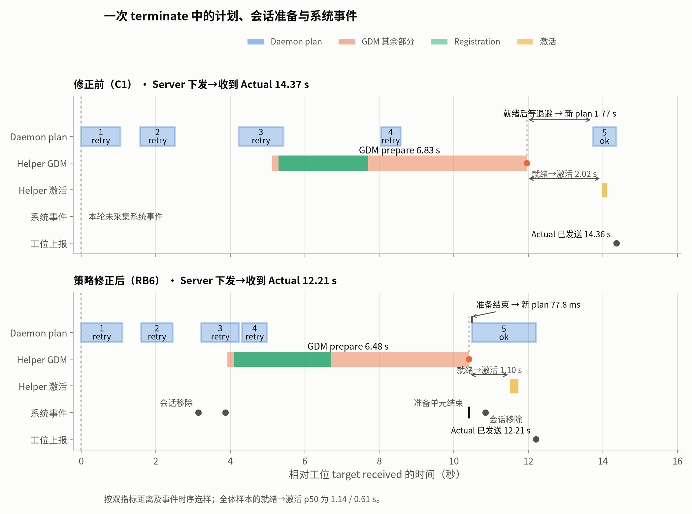
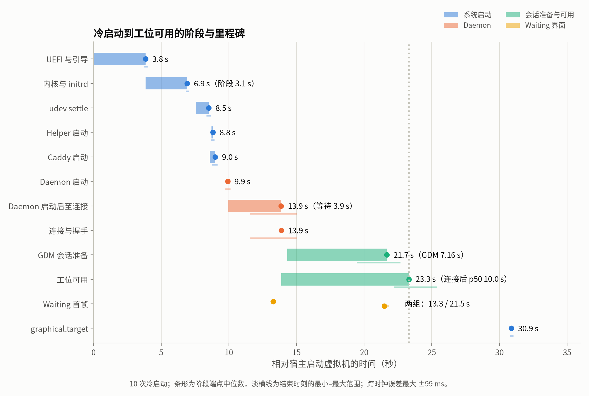
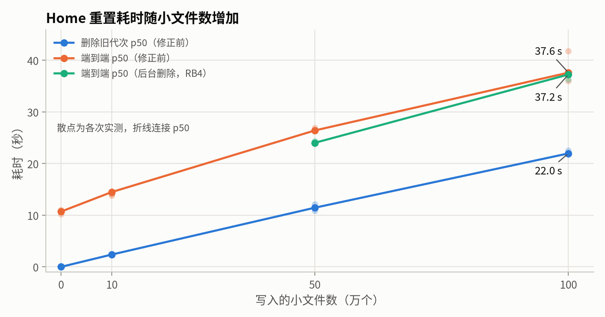
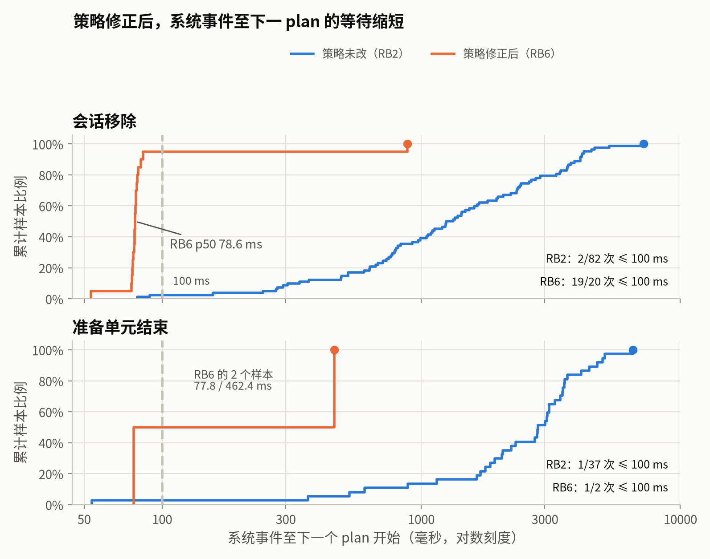
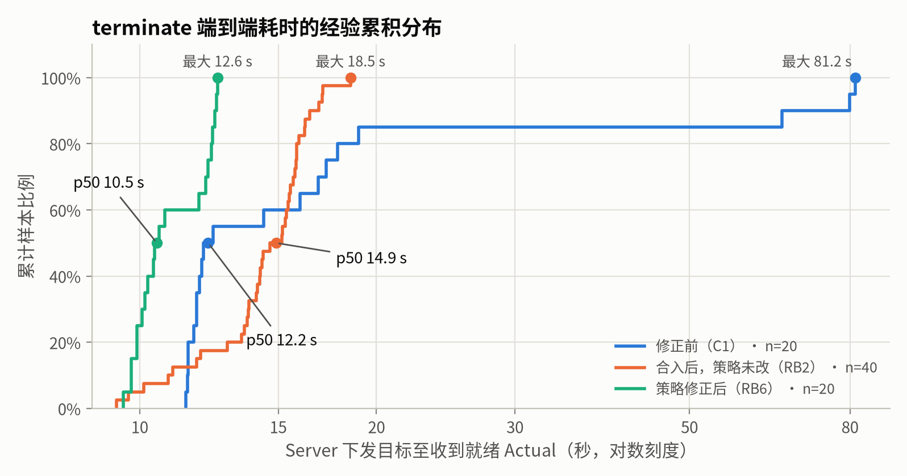
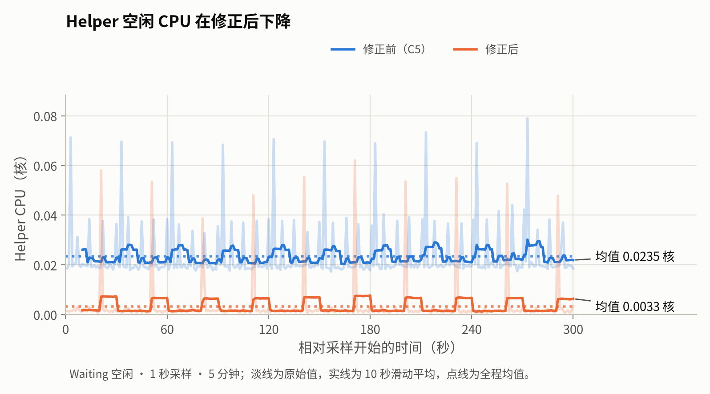

> [上一篇](/posts/natsume-v2-field-review-and-server-load/)用现场日志和双机压测考察了 Server。工位端在现场没有留下日志，目标下发之后在工位上经历了什么、各步骤花了多少时间、出故障时会怎样恢复，都只能另行测量，因此有了此文。本文是 Natsume 工程分析系列的第三篇。

## 目录

## 实验环境

工位实验放在 B 上的虚拟机中进行。B 安装 QEMU，虚拟机为 q35 机型、OVMF UEFI、virtio 磁盘与网卡、user 模式 NAT，每台 2 个 vCPU、4 GiB 内存。B 的 NUMA node1 只有 CPU 没有本地内存，因此虚拟机的 CPU 绑定在 node1，内存放在 node0，与负载生成器共享内存带宽。Server 运行在 A 上，与上一篇相同，使用独立的数据目录和 systemd 单元，生产服务全程处于停用状态。

模板盘由比赛镜像无人值守安装得到，之后只读；每台工位是模板上的一个 qcow2 overlay。克隆盘的内容完全相同，这正是 v1 克隆磁盘事故的场景。v2 的硬件身份取 DMI system UUID、主板序列号与根盘序列号三取二，所以每台虚拟机通过 QEMU 的 `-smbios type=1,uuid=…`、`type=2,serial=…` 和 `-drive serial=…` 给出不同的取值，同时清空 machine-id、使用不同的 MAC。实验需要从宿主进入虚拟机执行检查，比赛镜像没有 qemu-guest-agent，我把它和一个依赖离线装进了 overlay，这是相对比赛镜像唯一的软件增量。镜像中的部署秘密（口令哈希、许可证、SSH 公钥、现场 CA）只存在于 B，模板盘与克隆盘不离开 B。

最初的计划是用现场镜像中的 Client 2.6.0 搭配同版本的 Server 测量，冒烟测试中 Waiting 到 Contest 约 1.5 秒、返回约 0.6 秒。但 2.6.0 在成功路径上几乎不写日志，也没有 `/run/natsume-diagnostics`，只能得到首尾两个时间点。赛后 Client 的控制逻辑变化不大，因此改用当前主分支（下文称 HEAD）的 Server 与 Client，并在 HEAD 中补充了一组观测事件，见下一节。

换用 HEAD Client 之后，绑定无法完成：Helper 把 Home 保持在 `recovery_required`。原因有两个，都在镜像一侧。其一，HEAD 的 Home 重置要求镜像提供 `/etc/natsume/contest-reset-policy`，这一策略在比赛之后才加入镜像仓库；其二，现场镜像的 `/etc` 模式为 0775，`/etc` 下共有 55 个目录可被组写入，是镜像构建时检出目录的 umask 被带入 rootfs 所致，镜像仓库已在 `499d631` 修复。Helper 要求策略文件及其父目录均属 root 且不可被组和其他用户写入，否则拒绝发布重置完成。我先按镜像仓库为已部署工位提供的维护流程在两台虚拟机上补齐了策略，验证观测链路可用；随后在 A 上用镜像仓库当前版本 `f0c0507` 重新构建比赛镜像（约 37 分钟），重装模板并重建工位。新模板原生提供策略文件，同口径审计的组可写目录从 57 个降为 1 个，首次启动后 Home 即为 steady。镜像内置的 Client 为 2.10.0，安装模板后再升级为 HEAD 的 2.12.0 构建。下文的所有数据都来自这一环境。

A、B 启用 chrony，虚拟机启用 systemd-timesyncd。即便如此，测量期间虚拟机相对 A 的偏差在 −94 至 +11 ms 之间变化，按校准点计算的误差包络约 ±55 ms，远大于 A 与工位之间 1 至 3 ms 的单向传输时间。因此下文的跨机耗时只给端到端值（起止都在 A 上），工位内部各阶段只使用工位本机的 monotonic 时钟。

虚拟机构建脚本、实验运行器和采集器位于仓库的 `bench/vm/`，主机、设备和路径通过 `NATSUME_BENCH_ENV` 配置。比赛镜像含部署秘密，不公开；复现需要用镜像仓库自行构建 seeded ISO。

## 观测点

控制协议传输的是完整的期望状态，没有序号，Server 下发的目标与工位上报的 Actual 之间原本没有可以对应的标识。HEAD 的做法是在协议 crate 中定义 `target_digest`：把下发的 `ConcreteTargetState` 中的绑定口令字段置空，其余字段保持原值，对 prost 编码计算 SHA-256，取前 8 字节。Server 在写出目标时、Daemon 在收到目标和完成收敛时都记录这一摘要，不需要修改协议。Daemon 另外为每次收敛尝试分配本地递增的 `plan` 编号，重试使用新编号，用于区分同一目标下的多次尝试。

新增事件全部为 INFO 级别，在对应步骤的结果已知时写出，带耗时字段。Server 端为 `target dispatched` 与 `actual received`；Daemon 端为 `target received`、`reconcile completed`、各资源步骤（Session、Home、Caddy、Binding eligibility）的完成事件和 `actual sent`；Helper 记录会话切换和 Home 重置的分段耗时；Waiting 界面的 Agent 记录每个界面版本的首帧。`reconcile completed` 把一次收敛拆为六个互不重叠的阶段：inspect_guard、configuration、maintenance、access、power、snapshot。在本文的所有收敛样本中，六个阶段之和与总耗时的差值都在 1 至 4 µs 之间。这一轮测量时 Server 的 `actual received` 还不带摘要，最后一跳依靠串行操作的时间窗口和 convergence API 的接收时间对应。

日志采集在源端过滤：A 上的 journald 在返回前、工位上的 journald 在 qemu-guest-agent 返回前，只保留事件名、摘要、plan、结果枚举和数值字段，任何错误正文、路径、账号和配置都不离开主机。

## 收敛时延

测量对象是 Server 写出目标到收到对应 Actual 的时间，起止都在 A 上。ws01 每类操作 20 次，ws02 每类 5 次，两台串行执行，每次收敛后冷却 3 秒；125 个样本全部收敛。ws01 的结果如下，ws02 与之相近：

| 操作 | p50 | p90 | 最大 |
| --- | ---: | ---: | ---: |
| Waiting → Contest | 1.35 s | 1.57 s | 2.20 s |
| Contest → Waiting | 0.55 s | 0.64 s | 0.70 s |
| 重新绑定 | 0.92 s | 1.01 s | 1.06 s |
| Home 重置 | 11.1 s | 11.8 s | 13.9 s |
| terminate | 12.2 s | 67.0 s | 81.2 s |

前台切换不重建会话，Daemon 的 maintenance 阶段在 Waiting → Contest 中约 1.0 s，其中 Helper 激活已有会话约 0.2 至 0.6 s，其余为桌面就绪的确认。Server 到工位、工位到 Server 的单向时间都在毫秒级，相对端到端可以忽略。

terminate 与 Home 重置都需要销毁原 Contest 会话并重新登录，耗时集中在 GDM 准备新会话，Helper 记录的 `prepare_us` p50 为 7.06 s，包括 greeter 注册、认证和桌面初始化。剩余的时间来自重试。ws01 的每次 Home 重置都经历 3 次重试，terminate 为 3 至 7 次。按源码和固定错误分类，重试有两个来源。一是 logind 的 Terminate 是异步的，Helper 调用后立即检查会话是否仍然存在，存在则返回 Unavailable，Daemon 保留终止意图，在后续 plan 中重新检查。二是 GDM 准备过程持有图形操作锁，准备期间 Daemon 发起的 Activate 在锁检查处立即返回 Unavailable。这两种都是有意设计的互斥。

但重试的时机由 Daemon 的指数退避决定：首次等待 0.5 至 1 s，此后每次翻倍，每次在 [d/2, d] 内随机取值，上限 30 s。会话准备完成或旧会话退出时不会唤醒 Daemon，它要等当前退避到期才发起下一次 Activate。从 Helper 报告新会话就绪到下一次激活开始，ws01 的 terminate 中 p50 为 1.1 s，最大 26.6 s。若在准备完成、会话退出时主动唤醒收敛，并保留退避作为兜底，这部分等待可以消除，上述 p50 即为该项修改收益的上界。

下图上半部分是一次 terminate 的实际过程：前四个 plan 都因旧会话尚未退出或 GDM 准备持有锁而重试，准备完成后又等了 1.77 s 退避才开始第 5 个 plan。下半部分是后文修正之后的同一操作。



terminate 的长尾另有原因。25 次 terminate 中有 4 次，GDM 准备在 Registration 阶段耗尽 35 s 的工作预算，以超时结束，之后的重试才成功，端到端达到 65 至 81 s。Registration 阶段要求固定的 greeter 探针可用，并且 GDM 对当前 greeter 身份的确认可以找到。现有的错误分类不能区分是探针不可用，还是确认与当前 greeter 不匹配；仅有的一次运行时探针结果指向前者，样本不足以下结论。这需要先补充分类再继续定位。

## 会话切换与开机

HEAD 的 Helper 在开机时预先创建 Contest 会话，就绪后切回 Waiting，并记录本次开机的预备完成标记，所以开机之后的第一次 Waiting → Contest 也只是激活已有会话。对 ws02 冷启动 10 次，每次可用后立即切换：开机后首次 Waiting → Contest 的 p50 为 1.56 s，同一次开机内之后的切换为 0.89 s。首次多出的约 0.67 s 中，一部分是因为 Server 在工位就绪时会重发当前的 Waiting 目标，紧接着提交的 Contest 目标需要先取消这个尚在执行的计划。真正的冷启动成本是开机期间的 GDM 准备，p50 为 7.16 s，它发生在工位被判定为可用之前。100 次切换都没有重试。

从宿主启动虚拟机到工位可用（Server 收到 Waiting 与 Contest 均就绪的 Actual），p50 为 23.3 s，最大 25.3 s。其中 UEFI 与引导约 3.8 s，内核和 initrd 约 3.1 s，udev settle 在 8.5 s 完成，Natsume 的三个系统服务在 8.8 至 9.9 s 之间就绪。Daemon 在 9.9 s 启动后约 4 s 才发起连接，这段等待是 Daemon 有意设计的 0 至 5 s 随机启动退避，用于在全场同时开机时打散连接。连接、握手和首个 Actual 几乎同时完成，此后约 10 s 用于开机期间的 Contest 准备。Waiting 首帧在 10 次中分成两组，6 次约 13.3 s、4 次约 21.5 s，原因尚未查明。`graphical.target` 要到 30.9 s 才达成，它受 `plymouth-quit-wait` 拖延，晚于工位实际可用的时间，不适合作为就绪的判据。



## Home 重置

Home 重置的耗时与选手写入的数据有关。在 Contest 中以选手身份写入不同规模的数据后提交重置，每个条件 5 次：



没有写入时删除旧代次只需 6.7 ms，端到端 10.7 s；写入一个 1 GB 的文件，删除也只要 63.7 ms，端到端 11.1 s。删除耗时取决于文件数而不是字节数，大约每个文件 22 µs，在 10 万到 100 万之间近似线性。`node_modules` 和 IDE 缓存都可以轻易产生这一数量级的小文件。

源码中与重置相关的两个期限并不约束这一步。1 秒期限只作用于 `/tmp`、`/var/tmp`、`/run/lock` 等位置的临时数据和 keyring、FUSE 清理，在所有样本中最长约 107 ms。8 秒是 Helper 对每个请求的异步超时，而旧代次的删除是同步的 `remove_dir_all`，超时无法在删除过程中抢占它。实际先触发的是 Daemon 系统总线连接上 10 秒的方法超时。50 万文件时，Daemon 的验证调用在 10 s 返回 rpc_error，进入重试；100 万文件时错误升级为 LocalControl，Daemon 退出当前控制连接并重新连接。Helper 并没有因为调用方超时而中断删除，删除完成后持久化 Verified。所有样本都在同一个重置 epoch 上恢复，删除期间比赛登录的准入一直关闭，完成后只剩一个 Home 代次，测试数据没有残留。安全性没有受影响，受影响的是控制面多走了一轮重试或重连。若要让期限真正生效，需要把清理改为可分批、可恢复的过程，同时保持同一 epoch 的进度和准入屏障。

## 资源占用

ws02 上各采样 5 分钟、间隔 1 s。Waiting 空闲时，Daemon 平均占用 0.006 个核，Caddy 0.0002，Agent 0.0014，Helper 0.024；比赛中选手编译占满一个核时，这些数值不变。内存方面，Daemon 的 RSS 为 11.7 MiB，Helper 6.9 MiB，Caddy 46 MiB，Agent 163 MiB，Waiting 用户的整个 cgroup（含桌面）约 560 MiB。校徽更新时 Agent 重绘一帧约消耗 34 ms CPU。

Helper 空闲时的 CPU 是 Daemon 的 4 倍，按线程和 cgroup 统计，其中 81% 至 83% 花在子进程上。原因是 Agent 每秒向 Daemon 查询一次界面快照，Daemon 每次都会经 Helper 完整检查当前会话，Helper 对 Waiting 和 Contest 各启动一个 `desktop-status` 子进程，重新连接 Wayland 并做两轮 roundtrip 查询输出与输入能力。30 s 内观察到 37 次查询、148 次 execve。界面查询只需要确认调用方的会话身份和租约，不需要检查两个桌面的就绪能力；把这两件事拆开，或改为界面版本变化时通知 Agent，可以去掉大部分开销。

## Caddy

Caddy 只在 Gateway 模式变化时重新加载配置，即 terminate、Home 重置和绑定变化，普通的前台切换不触发。每次加载顺序执行 validate、adapt、reload 三个子进程和一次 admin 比对，各约 50 至 70 ms、50 至 60 ms、50 至 70 ms 和 6 至 7 ms，合计约 0.17 至 0.2 s。相对于 terminate 和重置十秒以上的总时间，这一项不是瓶颈，改用 admin API 直接加载的收益有限。本地 Caddy 代理 DOMjudge 的额外延迟需要一个 DOMjudge 实例回放页面请求，这次没有测量。

## 工位端故障

每项注入前，先按源码和架构文档写下预期行为，再对照观察结果。

Home 重置删除 50 万个文件的过程中对 Helper 发送 SIGKILL，systemd 在 2.1 s 后重启 Helper，Helper 启动时按持久化的进度恢复同一 epoch，继续删除剩余的旧目录，准入一直关闭到验证完成。同样的时机下直接杀死 QEMU 进程模拟断电，重启后同样按同一 epoch 恢复，qcow2 检查无错误，从断电到两个会话重新就绪约 34 至 40 s。三次断电中第一次因为编排脚本的错误缺少重启初期的准入观测，另补测一次。

Caddy 被 SIGKILL 后，本地访问依次出现连接失败和 HTTP 503，2 至 5 s 后 Gateway 自动回到 READY。把 Caddy 的 admin socket 权限改为 000 使配置加载失败，加载 BLOCKED 配置在 reload 阶段失败，Daemon 按设计安全退出并强制终止旧 Caddy，重启后自动恢复。

比赛中断网 30 s，短于控制连接 60 s 的静默预算，连接和 Contest 会话都保持。断网 5 min 时，Server 在 49.9 s 以 ping_silence 清除 lease，工位在 58 s 判定连接结束，Gateway 转为 BLOCKED，本地访问返回 503，Contest 会话保留。恢复链路后 9.8 s 重新连接，断网期间在 Server 上提交的 Waiting 目标随即执行。这 9.8 s 主要是重连退避：退避窗口从 0 至 5 s 开始翻倍到 0 至 30 s，在窗口内全区间随机取值，链路恢复不会提前唤醒。开机时 Server 拒绝连接或网络不可达，工位都进入离线的 Waiting，Gateway 为 BLOCKED，Server 或网络恢复后 10.5 s、24.1 s 自动收敛。网络丢包直到 10 s 连接超时的情形没有覆盖。

在 GDM 准备的 Registration 阶段暂停 greeter 的 gnome-shell，开机预备和 terminate 后重建各一次。两次都在 35.0 s 预算耗尽后以超时结束，0.2 s 内回到可用的 Waiting，Caddy 保持 BLOCKED，之后的重试自动成功，从恢复进程到 Contest 就绪 25 至 37 s，大部分仍是退避等待。计划中写的"每次开机只有一次预算、冷却 60 s"是 Waiting 界面自动重建的规则，Contest 的准备在同一次开机内可以多次重试。

Home 重置期间的登录拦截只做了只读检查：准入守卫读取的许可、窗口和锁在重置前允许、删除期间阻断、验证完成后允许，期间没有提前放行。真实的 GDM 登录需要选手口令，且 PAM 检查要求父进程为真实的 `gdm-session-worker`，这一部分没有执行。

## Server 端故障

对 Server 执行 SIGKILL，5 s 后重启，两台虚拟机和 16 台模拟工位全部重新连接，两次分别用时 22.7 s 和 27.6 s，第二次较慢是因为两次故障间隔不足 60 s，退避窗口还没有重置。工位的前台、Home 与 terminate 的 epoch 不变，没有重复执行重置或终止，数据库完整性检查通过。网络分区 30 s 时 lease 保留，90 s 时在 52.7 s 清除，两种情况下分区期间提交的目标都被保存，恢复后自动执行。

对业务库持有写锁 7 s，单次 5 s 的 busy_timeout 足以等到释放，lease 不受影响；持有 36 s 时，DeviceActor 连续失败 3 次，间隔约 10 s（5 s 的 SQLite 等待加 5 s 的重试间隔），随后以 transient_limit 终止 lease，工位重新连接，锁释放后收敛。事务中 permit、连接池与写锁的等待时间当时只记录在 DEBUG span 上，INFO 级别下看不到。

工位以 50 ms 间隔上报状态时对其执行 disable 和 revoke，authority 提交之后不再接纳该 lease 的 Actual，最后一条比生命周期事件早 20 至 23 ms。运营事件日志的存储不可写时，业务操作不受影响，日志进入 degraded，60 s 后自动重试成功，期间丢失的 75 条事件只写入分类摘要，不补写原事件；磁盘真正写满的情形没有覆盖。一个停止读取的客户端在 2.5 s 后因 outbound_backpressure 被单独断开，同期两台虚拟机的切换耗时为 0.59 至 0.90 s，只有一组对照，不足以说明完全没有影响。

最后是 v1 克隆磁盘事故的对应场景：克隆一台与 ws01 硬件身份完全相同的 ws03。注册窗口关闭时，ws03 以相同的硬件身份提交新的控制密钥，进入待审核，ws01 的连接和记录不受影响，没有产生新的设备。但这一结论依赖窗口关闭。窗口开放时，HEAD 会自动批准同一硬件身份的新密钥并替换原设备的 authority；若克隆盘连同已注册的私钥一起复制，两台机器在 Server 看来是同一个设备，会互相替换连接。HEAD 没有区分这两台物理机器的手段。更进一步，原机器的密钥一旦被替换，HEAD 不允许重新批准已退休的密钥，Daemon 也没有更换密钥的运维命令，原机器没有受支持的恢复路径，因此这一变体没有执行。现场布置阶段通常会开放注册窗口，这一点需要在流程上约束，或者在设计上补充。

## 修正与复测

上面的测量指出的问题，大部分可以在工位端修正：会话准备完成和会话退出时主动唤醒收敛；拆分界面查询与桌面就绪检查；旧 Home 代次改为后台删除；补充 Registration 超时的分类、`actual received` 的摘要和数据库等待的 INFO 事件；校徽轮询加入随机抖动。这些修改合入主分支 `e6cd39d` 之后，我在同一环境中用同一组运行器重新测量。Server 换用新构建和一份停机复制的数据目录，两台虚拟机原地重装同版本号的新 Client，运行中三个进程的 `/proc/<pid>/exe` 哈希与新构建一致，原有的设备、座位和绑定保持不变。

### 唤醒没有生效

冒烟测试中单次 terminate 用了 15.8 s，Home 重置 13.6 s，各自仍然需要 5 个 plan，与修正前没有区别。完整复测的结果是 ws01 的 terminate p50 14.9 s、最大 18.5 s，Home 重置 p50 12.0 s，从新会话就绪到下一次激活的 p50 反而从 1.1 s 变为 3.0 s。修正前 65 至 81 s 的长尾这次没有出现，但这一轮 40 次 terminate 中 Registration 超时为 0 次，长尾消失与唤醒无关。

唤醒的实现是 Daemon 在系统总线上订阅 logind 的 `SessionRemoved` 和 systemd 的 `JobRemoved`（只匹配 Waiting、Contest 两个准备单元），收到后把已有的重试期限提前到 75 ms 之后，退避档位不变。按事件对齐，ws01 的 terminate 中，在两个 plan 之间发生的 37 次准备单元结束里，只有 1 次在 100 ms 内开始了下一个 plan，82 次会话移除中只有 2 次，其余的间隔都落在退避档位上。Daemon 没有记录订阅失败，总线上也登记着它的两条匹配规则。

源码中唤醒和退避到期都要求 Daemon 的执行器空闲，即没有正在执行或排队的 plan，也没有正在进行的本地 observation，所以可能的原因有两个：信号没有到达 Daemon，或者到达时一连串 observation 占着执行器。现有日志不足以区分，我在一个临时 worktree 中给 Daemon 加了几条只用于诊断的 INFO 事件（收到信号、唤醒生效、退避设定与到期、observation 的起止），不改控制流，只装到 ws01 上测量 10 次 terminate 和 5 次 Home 重置，结束后换回发布构建并核对哈希。结果很明确：15 次准备单元结束、36 次会话移除，Daemon 一条信号也没有收到；同期在总线上监测到 54 条相关信号，发送者都是对应服务当前的所有者。observation 只有一次把重试推迟了 51 ms，第二种原因不成立。

问题在 Client 包附带的 D-Bus 策略。Daemon 在系统总线上持有 `org.natsume.Device1` 这个名称，供 Waiting 界面的 Agent 调用，策略为：

```xml
<policy user="waiting"><allow send_destination="org.natsume.Device1"/></policy>
<policy context="default"><deny send_destination="org.natsume.Device1"/></policy>
```

dbus-daemon 按名称的所有者连接执行 `send_destination` 规则，这条 deny 没有限定 `send_type`，因此也拦截了 logind 和 systemd 发往这个连接的广播信号。Daemon 恰好在持有 Device1 的同一个连接上订阅唤醒信号。我在一条私有总线上用相同的策略复现了这一点：同一个连接申请 Device1 之前、释放之后都能收到两类信号，持有期间一条也收不到。Helper 的 `org.natsume.Privileged1` 策略早已把同样的 deny 限定为 `send_type="method_call"`，注释中写的正是这个原因，Device1 的策略漏了这一处。

修正只有一行（`e6befb1`），限定 deny 只作用于方法调用。重新打包安装后，Waiting 界面对 Device1 的调用正常，其他账号的调用仍然得到 `AccessDenied`。在两个 plan 之间发生的会话移除，下一个 plan 开始的中位数约为 79 ms，ws01 的 terminate 中 20 次有 19 次落在 100 ms 以内；准备单元结束大多发生在 plan 执行之中，落在两个 plan 之间的只有 2 次，分别为 78 ms 和 462 ms。



terminate 的端到端随之缩短：p50 从合入后的 14.9 s 降到 10.5 s，最大值从 18.5 s 降到 12.6 s，也都低于修正前的 12.2 s 和 81.2 s。



修正前、合入后、策略修正后三轮，ws01 的 Home 重置 p50 依次为 11.1、12.0、11.1 s，terminate 中从新会话就绪到下一次激活的 p50 依次为 1.1、3.0、0.61 s。

剩下的约 0.6 至 0.9 s 不再是等待：下一个 plan 在激活之前还要做完 inspect、维护检查和多次受管会话查询，每次查询都会对两个桌面执行就绪探针。Home 重置的端到端没有明显变化，它的主要部分是 GDM 准备新会话的约 7.4 s。

### Registration 超时

补充分类之后，Registration 阶段的每次失败都带有阶段、类别和计时字段。三轮复测中，Registration 超时分别为 40 次中 0 次、40 次中 4 次和 50 次中 1 次，全部是 `probe` 阶段的 `probe_unavailable`，即固定的 greeter 探针在 35 s 预算内一直不可用；成功的 Registration 都在 3.4 s 以内完成。修正前的 4 次超时无法区分的两种情况，至少在这些样本中都是前者。

暂停 greeter 的故障注入在策略修正后重测了 4 次。greeter 恢复后，下一次准备在 0.65 至 1.1 s 内开始，修正前为 14.7 至 17.1 s。但 4 次中有 3 次，紧接着的这次准备再次以 `probe_unavailable` 超时，第三次准备才在 0.13 至 0.25 s 内完成 Registration，恢复到 Contest 就绪因此仍需 42 至 43 s；没有出现第二次超时的一次只用了 7.8 s，修正前为 37.1 s。被暂停过的 greeter 恢复之后，探针在下一个 35 s 内仍然不可用，这与正常 terminate 中零星出现的超时可能是同一个原因，具体原因没有继续定位。

### Helper 空闲 CPU

界面快照和租约续期改为只校验调用方的会话身份、boot 和租约，不再执行桌面探针。Helper 空闲时的 CPU 从约 0.024 个核降到 0.0033 个核，Waiting 和 Contest 状态下相同，30 s 内的 execve 从 148 次降为 12 次。剩下的 12 次来自 Daemon 每 30 s 一次的本地安全观察：一次受管会话查询对两个角色各执行一次 `setpriv` 和 `desktop-status`，这是有意保留的周期复核，也就是下图修正后每 30 s 出现一次的小台阶。Daemon 的 CPU 约 0.0055 个核，与修正前相同。



### 大 Home 的删除

VerifyHomeReset 改为启动或查询进度：Helper 把进度持久化为进行中，在后台任务中删除旧代次，调用立即返回；Daemon 在进行中按 0.5 至 1 s 的间隔轮询，不增长退避。删除期间维护窗口和准入屏障保持不变。50 万和 100 万个小文件各测 3 次，删除本身仍需 11 至 13 s 和 23 s，端到端 p50 为 24.0 s 和 37.2 s，与修正前的 26.4 s、37.6 s 接近（前文 Home 重置一图中的绿线），但再没有出现 rpc_error、LocalControl 或重新连接，Verify 调用最长 223 ms。

故障注入改用 100 万个文件。删除进行中对 Helper 发送 SIGKILL，新的 Helper 启动时按持久化的进度在原 epoch 继续删除并完成验证；Daemon 的 systemd 单元依赖 Helper，Helper 退出时 Daemon 也随之重启，因此出现了 2 次 LocalControl，这符合 Helper 失联时关闭访问、重建控制连接的设计。删除进行中断电，开机后在原 epoch 恢复删除，从断电到就绪 52.6 s。两种情况下准入都一直关闭到验证完成，最后只剩一个 Home 代次，测试数据没有残留。

### 观测与校徽轮询

Server 的 `actual received` 带上了 `target_digest`，与 `target dispatched`、工位 `target received` 中的摘要一致，链路两端不再依赖时间窗口对应。事务等待之和超过 100 ms 时输出一条 INFO 事件，对业务库持有写锁 3 s，期间的一次写事务记录了 631 ms 的写锁等待。

校徽轮询的间隔改为每轮在 45 至 75 s 中随机取值，首次 0 至 60 s，目标变化或重连之后 0 至 5 s。两台工位稳态 12 min 内的请求间隔为 45.0 至 73.6 s 和 49.3 至 69.6 s，全部返回 304，相位不再对齐；重连后 1.0 s 发出了重验请求。前台在 Waiting 和 Contest 之间切换不改变展示资料，不会触发快速重验。
